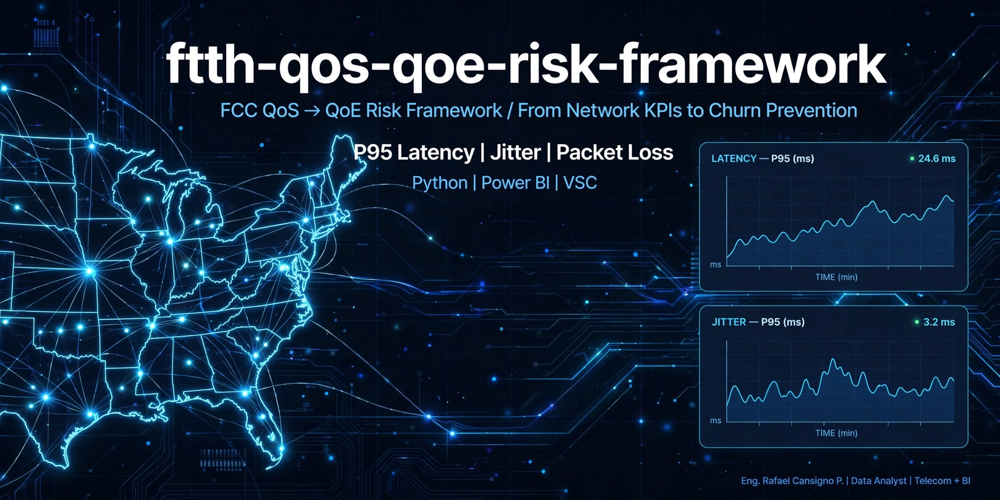
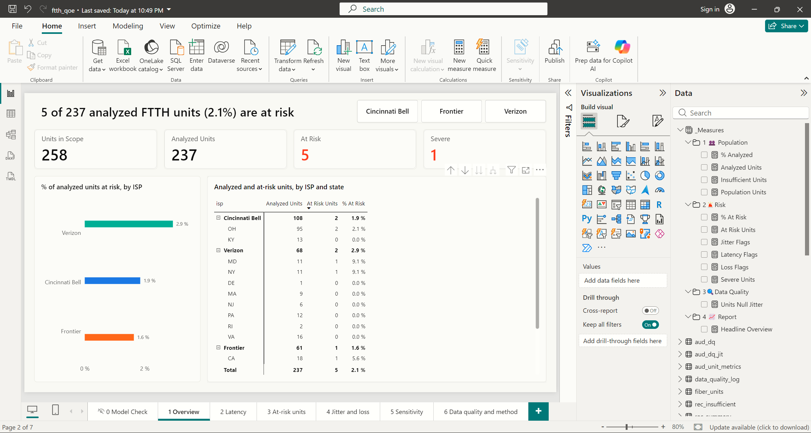

# ftth-qos-qoe-risk-framework
### FCC QoE Risk Analysis / Análisis de Riesgo QoE

**Author:** Eng. Rafael Cansigno P. | Data Analyst | Telecom + BI · Google Data Analytics Capstone (Track B, self-directed) · September–October 2026
**Stack:** Python | Power BI | VS Code
**KPIs:** P95 Latency | Jitter | Packet Loss

> Identifying fiber (FTTH) subscribers at risk of poor Quality of Experience (QoE) from FCC Measuring Broadband America telemetry, using a reproducible and auditable pipeline.

[](LICENSE)


---

## 1. Project Summary

This project uses FCC Measuring Broadband America (MBA) telemetry from 2022 to answer one question:

> Which FTTH units show degraded QoE during peak hours, and how much of that degradation is real versus an artifact of the measurement instrument or the analysis?

The analysis focuses on three metrics measured in the local evening peak window: latency (P95), jitter (P95) and packet loss.

**Why P95 instead of the average?** The average hides the tail: a unit can have a 15 ms average latency and still show much higher values in a share of its hours. The 95th percentile (P95) is the value that 95% of the measurements do not exceed, so it describes the poorer end of the distribution, where bad QoE lives. Each `rtt_avg` value is itself the average of one hourly test, so the P95 here summarizes the *hourly averages*; spikes inside a single test are only visible in `rtt_max`.

**Current status:** Methodology v3 is specified (`docs/metrics_spec.md` v1.2.0, decisions D-01 to D-10) and the data inspection (Step 0) and the exploration scripts (`src/steps/step_0.py` to `step_11.py`) are complete. The single pipeline (`src/pipeline.py`) and its automated tests (`tests/`, 21 passing) are complete, and the pipeline reproduces the exploration figures unit by unit. The Python ↔ Power BI reconciliation is complete (258 units, 0 mismatches; [`docs/reconciliation.md`](docs/reconciliation.md)), so the base-case figures in [`docs/procedure_summary_v3.md`](docs/procedure_summary_v3.md) and `data/processed/` are confirmed results. The Power BI report is complete (6 pages, exported to [`powerbi/ftth_qoe_report.pdf`](powerbi/ftth_qoe_report.pdf); row-level security tested in Desktop; implementation log in [`docs/powerbi_implementation.md`](docs/powerbi_implementation.md)).

## 2. Why Version 3 Was Necessary

The project went through two methodology iterations. Each one found a real problem, and the audit of the second one showed that patching it was less reliable than rebuilding it on a single, verified specification.

| Version | What it did | What it revealed |
| :--- | :--- | :--- |
| **v1** | Read the first 1,000 rows of each monthly FCC file | **Convenience bias:** the sample was dominated by legacy enrollments, not representative of the fleet |
| **v2 / v2.1.3** | Filtered FTTH units by hardware (285 → 258) and flagged risk by latency only | **Instrument bias solved:** legacy Whiteboxes (low CPU, FastEthernet) created false latency and loss. **New problem:** packet loss was computed from a raw count (`packets`) treated as a percentage |
| **v2.2** | Patched loss with `packets/10`, capped at 100%, and filled nulls with 0 | **Patch masked data issues** and left the two implementations inconsistent (details below) |
| **v3** | Single specification, single implementation, verified inputs | Current version |

### Findings that drove the rebuild

1. **The loss field was misinterpreted.** In v2.1.3, values such as `10055` were read as 1,005% loss, and the v2.2 fix assumed 1,000 datagrams per test (`packets/10`). According to the FCC MBA Technical Appendix data dictionary, `curr_udpcloss.csv` records **outage/disconnection events** (`duration` and `packets`, the number of packets lost in the event), not a per-test loss percentage. Packet loss is defined from `curr_udplatency.csv` as `failures / (successes + failures)`. The `packets/10` conversion therefore had no valid basis, and the 34.5% risk it produced was an artifact.
2. **Corrections hid problems instead of exposing them.** Capping values at 100% turned corrupt counters into "total loss", and `fillna(0)` made a unit with no data look perfect (0 ms latency, 0 ms jitter).
3. **Python and Power BI implemented the metrics differently.** The documented versions differed in the UTC offset used (`timezone_offset` vs `timezone_offset_dst`; the data period is under daylight saving time), the peak window (19:00–22:59 vs 19:00–23:59) and the loss source (`curr_udplatency` failures/successes vs `curr_udpcloss` packets, which measure different things). Matching totals could not prove they matched unit by unit.
4. **Risk thresholds changed without justification.** The flag moved from latency > 20 ms / jitter > 15 ms / loss > 1% to latency > 50 ms / jitter > 5 ms / loss > 1%. With the observed distribution, the jitter condition never triggered and the latency condition triggered for a single unit, so the result depended almost entirely on the misinterpreted loss metric.
5. **Results were not reproducible from the repository.** The scripts that generated the datasets were not versioned, several documents cited files that did not exist, and key figures (units at risk, mean loss) differed across documents.

### What v3 changes

- **One specification** (`docs/metrics_spec.md`) that defines every metric, window and threshold. Code follows the spec, never the other way around.
- **One implementation** of each transformation, in Python. Power BI only visualizes the processed output.
- **Data inspection first:** column definitions and units are verified against the FCC documentation and the real files before any metric is computed (`docs/data_dictionary.md`, `docs/data_inspection.md`, `data/CSV_previews.md`).
- **No capping and no zero-filling.** Invalid records are excluded and counted in a data-quality log; units without enough data are reported separately, not scored.
- **Unit-level reconciliation** between Python and Power BI (per `Unit ID`, with explicit tolerances), instead of comparing totals.
- **Parameterized thresholds** with a sensitivity analysis. They are project-defined operating thresholds, not values attributed to a standard until verified in the source, and they are not tuned to the results.
- **Every decision is logged** with its alternatives and evidence (`docs/decisions.md`).

## 3. Methodology v3 (Summary) - Aligned to config.yaml v3.0

Full definitions are in [`docs/metrics_spec.md`](docs/metrics_spec.md) v1.2.0 and [`config.yaml`](config.yaml) is the single source of truth for values. Decisions in [`docs/decisions.md`](docs/decisions.md).

**Analysis period (D-01)**
- Full observed period inclusive: `2022-09-12` to `2022-10-31` (50 days). Rationale: September alone gives ~32 peak records per unit (P95 rests on ~1.6 obs); full period gives ~120 (~6 obs for P95). See `config.yaml` `analysis_period`.

**Population**
- FTTH units in the FCC unit profile (285), filtered to gigabit-capable Whitebox models (`skwb8`, `skwb8p`, `ac1750v2`) → **258 units**. The 27 excluded legacy units (`wnr3500l-high` 17, `wdr3600` 6, `wr1043nd` 2, `wr741nd` 1, `wr741ndv4` 1) are in `data/excluded_legacy_ftth_units.csv` and reproduced from `data/unit-profile-sept2022.xlsx`. `data/excluded_legacy_units.csv` contains all out-of-scope units (audit).
- The 258 units belong to three ISPs (Cincinnati Bell 120, Verizon 76, Frontier 62) in 16 US states.
- Allowed TZ offsets: `[-4, -5, -7]` hours (`timezone_offset_dst`). Any other value stops the pipeline. See `config.yaml` `population`.
- Rationale: the Whitebox is the measurement instrument. A device that cannot forward traffic at line rate creates the degradation it reports. Filter uses nominal capability, not per-unit throughput test (see Limitations).

**Peak window - DECISION D-03**
- **D-03 (2026-10-11): `dtime` is treated as LOCAL time, not UTC.** Implemented in `src/pipeline.py`: `local_hour = hour(dtime)`. No offset added. `dtime_format: "%Y-%m-%d %H:%M:%S"` string with no TZ marker (verified Step 0, not unix epoch).
- Evidence (Step 7/8): FCC dictionary says UTC, but hourly RTT profile of Pacific units (UTC-7) does not trail Eastern (UTC-4) by 3h as UTC would imply. Correlation at +3h shift ~0 or negative; best alignment -1 to -2h, much closer to 0 (local) than to +3 (UTC).
  - Cable: k=0 corr 0.762 vs k=+3 -0.107, best k=-1 0.892, peak Eastern 21h / Pacific 20h (dtime hour)
  - DSL: k=0 0.594 vs k=+3 -0.018, best k=-2 0.799, peak 21h/19h
  - Conclusion: indirect proof, does not prove FCC docs wrong, only that latency data does not behave as FCC says. Fiber was not tested (only 18 Pacific units). See `docs/decisions.md`.
- `timezone_offset_dst` in HOURS (-4,-5,-7), all 258 observe DST, verified but NOT used to compute window. Kept as sensitivity analysis per `config.yaml` `time.sensitivity_utc_reading`: `local_hour = hour(dtime + timezone_offset_dst)`.
- Peak window: local hour >=19 and <23 (19:00:00 to 22:59:59 local) per `time.peak_start_hour: 19`, `peak_end_hour_exclusive: 23`

**Server rule - DECISIONS D-04 and D-06**
- **D-04 (2026-10-11): `primary_only` as base case** (vs `all_servers` variant). Rationale: a unit uses 1 to 4 servers at different distances. Access line is same, RTT differences reflect distance/route, not line. Mixing servers inflated risk: 21 units at risk with all servers vs 5 with the primary server in the base case (`N_MIN` applied, `step_9.py`).
- **D-06:** the primary server is the target with the most peak-window records of the **latency** file (ties by alphabetical order of target) and is used for latency, loss and jitter. See `config.yaml` `server_rule`.
- Sensitivity Variant `all_servers` reported with every result.

**Metrics (per unit, peak window only, after server rule, after D-03/D-04/D-06)**
- `p95_latency_ms`: 95th percentile of `rtt_avg` (µs → ms via /1000). `percentile: 0.95`, `percentile_method: linear` (pandas quantile default, same as PERCENTILE.INC). Description: P95 describes tail where bad QoE lives.
- `p95_jitter_ms`: 95th percentile of average of up/down jitter `(jitter_up + jitter_down)/2` (µs → ms; the unit is supported indirectly, not documented; values 0.2-55 ms). Same percentile/method. **D-07:** evaluated only with at least 50 peak jitter records on the primary server; otherwise null, never 0 (latency and loss still scored).
- `loss_pct`: `sum(failures) / sum(successes + failures) * 100` ratio_of_sums weighted by packets (successes+failures varies 50-2,401 per row), from `curr_udplatency` (NOT `curr_udpcloss`). See `config.yaml` `metrics.loss`.
- **D-10, descriptive columns:** `n_days_above_threshold` and `p95_latency_without_worst_day_ms`, computed for every analyzed unit. They are not part of `risk_flag`.

**Data quality v3.0**
- No capping, no fillna(0): `data_quality.no_capping: true`, `no_fillna_zero: true`. v2.2 hid problems.
- Invalid records excluded and counted: `successes+failures<=0`, loss outside [0,100], rtt_avg null/negative, jitter null/negative, dtime not parseable. Step 0 and `step_9.py` found 0 for each.
- Duplicates key `[unit_id, dtime, target]` policy `keep_one_if_identical_else_drop_all` (D-05): latency 16 rows in 7 groups all exact, jitter 10 rows 8 exact 2 conflicting (unit 943232).
- `n_min_peak_records: 50` (D-02) - Top 5% of 50 = 2.5 obs. Counted after the server rule on latency peak records. Units below are reported in `units_insufficient_data.csv` and NOT scored.
- Outputs: `data/processed/ftth_qoe_unit_metrics.csv`, `units_insufficient_data.csv`, `data_quality_log.csv` (CSV only, no Parquet, version in git tags)

**Risk definition**
- `risk_flag = 1 if p95_latency_ms > latency_p95_ms OR p95_jitter_ms > jitter_p95_ms OR loss_pct > loss_pct` (strictly greater). Thresholds live in `config.yaml` `thresholds.base: 20/5/1.0`, `severe: 50/15/10` and are project-defined operating thresholds (NOT values attributed to standard).
- **D-09:** jitter stays in the rule although no unit exceeds it in the base case; thresholds are not adjusted to the results.
- `risk_severe` second tier separates extreme cases.
- **D-10:** the rule does not change for episodic events. A latency flag is described as *episodic* when the P95 without the worst day falls to the threshold or below, and *persistent* otherwise (descriptive only).
- **D-08:** sensitivity grid reported with every result per `thresholds.sensitivity`: latency [20, 30, 50] × jitter [3, 4, 5] × loss [0.05, 0.1, 0.5, 1.0] × `N_MIN` [30, 50, 100], plus the UTC reading and all-servers variants.
- Base case (D-03 local + D-04 primary server; `pipeline.py` reproduces `step_9.py`): 237 analyzed / 21 insufficient / 5 at risk (2.1%), 4 persistent and 1 episodic (D-10); between 1 and 7 at risk depending on `N_MIN`. Confirmed by the Python ↔ Power BI reconciliation: 258 units compared, 0 mismatches (`docs/reconciliation.md`).

## 4. Repository Structure

```
ftth-qos-qoe-risk-framework/
├── assets/                  # banner main_banner.jpg
├── archive/                 # methodology v1 (failed) and v2 material, kept as a record
├── evidence/                # screenshots: raw archive contents, FTTH filter
├── data/
│   ├── fiber_units.csv      # 258 FTTH units (gigabit-capable Whitebox models)
│   ├── excluded_legacy_ftth_units.csv  # 27 legacy FTTH excluded (hardware not credible) - used by pipeline
│   ├── excluded_legacy_units.csv       # All out-of-scope (audit, includes 27)
│   ├── unit-profile-sept2022.xlsx   # FCC unit profile (source)
│   ├── CSV_previews.md      # first 10 rows of raw files (verified structure)
│   ├── interim/             # CSV intermediates created by step_1.py and pipeline.py, gitignored
│   └── processed/           # pipeline output (5 CSV files) and its README.md
├── docs/
│   ├── metrics_spec.md      # source of truth v1.2.0 for all metrics
│   ├── decisions.md         # decision log D-01 to D-10 with alternatives and evidence
│   ├── data_dictionary.md   # meaning of every input column, with Step 0 verification (real vs FCC dictionary)
│   ├── data_inspection.md   # Step 0 results and checks
│   ├── procedure_summary_v3.md  # procedure overview, Step 0 to Step 11
│   ├── reconciliation.md    # Python ↔ Power BI unit-level reconciliation (258 units, 0 mismatches)
│   ├── powerbi_implementation.md  # Power BI implementation log (sessions 1-9)
│   ├── glossary_of_terms.md
│   ├── Capstone-FTTH-Executive-Brief-EN.md      # executive brief (English)
│   ├── Capstone-FTTH-Resumen-Ejecutivo.md       # executive brief (Spanish)
│   └── img/powerbi/         # numbered evidence screenshots (Figures 1-27)
├── src/
│   ├── README.md            # script map and how to run the steps
│   ├── steps/               # step_0.py ... step_11.py, step_11_1.py: exploration scripts, one per decision or check
│   └── pipeline.py          # single implementation; reads config.yaml and the config.local.yaml override
├── tests/                   # test_unit_metrics.py: 21 checks on data/processed
├── powerbi/                 # ftth_qoe.pbix, ftth_qoe_report.pdf and theme/ftth_qoe_theme.json
├── config.yaml              # single source of truth for values (methodology 3.0, spec 1.2.0, raw_dir: null)
├── config.local.yaml.example  # template for config.local.yaml (gitignored)
├── requirements.txt         # Python dependencies
├── .gitignore
└── LICENSE
```

Raw FCC data (6.8 GB) is NOT stored in the repository. Its local path is set in `config.local.yaml` (gitignored, created by each user). Example `config.local.yaml`:

```yaml
inputs:
  raw_dir: "D:/Capstone FTTH/data/raw/validated-data-sept2022"
```

`config.yaml` has `raw_dir: null` by design - local override pattern prevents absolute paths in repo.

## 5. Reproducibility

Raw data: FCC MBA validated data, 2022 release (13th Measuring Broadband America report), including `curr_udplatency.csv`, `curr_udpjitter.csv` and `curr_udpcloss.csv`. `curr_udpcloss` is reference only: outage events (`duration ~4.5s, packets 2-3`) NOT a loss metric.

1. Download and extract the files listed above to a local folder.
2. Create `config.local.yaml` (example in section 4) and set `raw_dir`.
3. Install dependencies: `pip install -r requirements.txt`
4. Exploration scripts: run `python src/steps/step_1.py` first (it creates the interim CSVs from the raw files), then any other step. They print to the console; the recorded output of each is in its `OUTPUT` docstring. The scripts read absolute Windows paths (`BASE`, `RAW`, `INTERIM`) that must be edited to run elsewhere (see `src/README.md`).
5. Run the pipeline: `python src/pipeline.py`. The first run reads the raw files (several minutes) and caches the FTTH rows in `data/interim/pipeline_*_ftth.csv`; later runs reuse the cache (`--refresh-cache` re-reads the raw files, `--no-variants` skips the 2×2 matrix and the D-08 grid). It writes the five files of `data/processed/` and reproduces the figures in `docs/procedure_summary_v3.md` unit by unit.
6. Validate with tests: `python -m pytest tests -v` (run from the repository root, after step 5). 21 checks: population 258/27 and exclusion files, `N_MIN`, jitter null only below the minimum and never 0, loss range, flags against thresholds, D-10 columns, data-quality log, and the base-case reference (237 / 21 / 5).
7. Reconcile Power BI (done): The Power BI report consumes ONLY `data/processed/`; an independent set of Power Query audit queries recomputes the metrics from `data/interim/` and is compared with `data/processed/` per `Unit ID` with the tolerances of `docs/metrics_spec.md` section 8 (±0.001 ms for P95 latency and jitter, ±0.001 percentage points for loss, exact match for `risk_flag`), saved in `docs/reconciliation.md`.

## 6. Roadmap

- [x] Hardware filter and population definition (258 units) - `data/fiber_units.csv`
- [x] Metrics specification v1.2.0 - `docs/metrics_spec.md`
- [x] Data dictionary with real vs FCC dictionary - `docs/data_dictionary.md`
- [x] Preview of the first rows of the raw files - `data/CSV_previews.md`
- [x] Repository restructure and archive of previous versions - `archive/`
- [x] Decisions D-01 to D-10 (period, `N_MIN`, local time, primary server, duplicates, jitter minimum, sensitivity grid, thresholds, episodic events) - `docs/decisions.md`, `config.yaml`
- [x] Data inspection of raw files and Step 0 checks - `docs/data_inspection.md`
- [x] Exploration scripts and sensitivity analysis (Step 0 to Step 11) - `src/steps/`, `docs/procedure_summary_v3.md`
- [x] Threshold and sensitivity grid selection from observed distributions - D-08, D-09, `thresholds.sensitivity`
- [x] Pipeline: raw → unit-level metrics (CSV) with DQ log - `src/pipeline.py`, `data/processed/`
- [x] Automated tests (21 passing) - `tests/test_unit_metrics.py`
- [x] Unit-level Python ↔ Power BI reconciliation - `docs/reconciliation.md`
- [x] Power BI report (6 pages, PDF export, RLS tested) - `powerbi/`, `docs/powerbi_implementation.md`
- [x] Results and findings section - section 7 of this README

## 7. Results and Findings

Base case: local time, primary server, `N_MIN` = 50, thresholds 20 ms / 5 ms / 1 % (D-01 to D-10). Figures come from `data/processed/` and were reproduced independently in Power BI (0 mismatches, [`docs/reconciliation.md`](docs/reconciliation.md)). The report is in [`powerbi/ftth_qoe_report.pdf`](powerbi/ftth_qoe_report.pdf) (six pages; the model is `powerbi/ftth_qoe.pbix`).



### Headline

**5 of 237 analyzed FTTH units (2.1 %) are at risk.** The other 21 of the 258 units in scope (8 %) have fewer than 50 peak records and are reported but not scored.

| ISP | Analyzed | Set aside | At risk | % at risk | Median P95 latency |
| :--- | :-: | :-: | :-: | :-: | :-: |
| Cincinnati Bell | 108 | 12 | 2 | 1.9 % | 13.6 ms |
| Frontier | 61 | 1 | 1 | 1.6 % | 7.3 ms |
| Verizon | 68 | 8 | 2 | 2.9 % | 12.0 ms |
| **Total** | **237** | **21** | **5** | **2.1 %** | **12.2 ms** |

The differences between ISPs rest on one or two units each, so they are not evidence that one provider performs better than another.

### Findings

1. **Latency is the only metric that separates units.** Five units exceed 20 ms P95 latency, none exceeds 5 ms P95 jitter and one exceeds 1 % loss. Unit 24840041 (Frontier, CA) exceeds both latency (35.8 ms) and loss (1.66 %); the next highest loss is 0.83 %.
2. **Most flags are persistent.** Four of the five at-risk units stay above 20 ms after removing their worst day. The fifth, 4190285 (Verizon, MD), is both **severe and episodic**: its P95 is 50.0035 ms, just above the 50 ms severe threshold and the only severe case, but it falls to 14.77 ms once its worst day (2022-10-23) is removed. The severe tier rests on an interpolated P95; no record equals 50 ms.
3. **Jitter cannot be assessed for 39 % of the analyzed units.** 93 units have fewer than 50 peak jitter records and their jitter stays empty (never 0): Cincinnati Bell 69 of 108, Verizon 17 of 68, Frontier 7 of 61. The jitter result covers 144 units (maximum 4.48 ms).
4. **Several units sit close to the threshold.** 34 units have a P95 latency between 15 and 20 ms, so a small change in the thresholds or the sample moves the count.
5. **The count depends on method choices, not only on the data.**

| Choice | Units at risk |
| :--- | :-: |
| Base case (local time, primary server, `N_MIN` 50) | 5 |
| All test servers instead of the primary one | 21 |
| UTC reading of `dtime`, primary server / all servers | 4 / 17 |
| `N_MIN` 30 / 50 / 100 | 7 / 5 / 1 |
| Whole threshold grid (108 combinations) | 1 to 30 |

The server rule has the largest effect, which is why the single-server rule (D-04, D-06) is documented as a decision, not a detail.

### What this means

- At the project thresholds, the large majority of the analyzed FTTH units show no peak-hour QoE risk, and the units that do are mostly latency cases that persist over time.
- The headline number belongs to one set of method choices. Using all servers or a lower `N_MIN` raises it (21 and 7); a higher `N_MIN` lowers it (1). It should be read with its sensitivity range, not as a single figure.
- Jitter and loss add little in this sample; latency drives the result. The jitter coverage gap is a data limit, not evidence of good jitter.

These results are bound by the limits in section 8: one period (2022), a non-random sample of volunteer units and project-defined thresholds.

## 8. Limitations

- Data from a single release period (2022) and a non-random sample of volunteer units; results do not generalize to all FTTH subscribers.
- The population covers three ISPs, and 220 of the 258 units (85%) are in the US Eastern time zone.
- Hardware suitability is based on the nominal capability of each Whitebox model, not on a per-unit throughput test.
- Risk thresholds are project-defined and their sensitivity is part of the reported results.
- The local-time reading of `dtime` rests on indirect evidence (Cable and DSL; Fiber was not tested) and contradicts the FCC general note; the UTC reading is reported as a sensitivity.
- The jitter unit (µs) is supported indirectly, not documented, and jitter is dominated by the upstream value. Jitter is evaluated for about 61% of the analyzed units in the base case; the rest have fewer than 50 peak jitter records.
- The number of units at risk is sensitive to `N_MIN`, and some flags are episodic (one day) or close to the threshold; both are reported with the result.
- Scope is the technical identification of QoE risk and degradation. Financial impact (truck rolls, churn, avoided costs) is not estimated: there is no source for unit costs, and the v1 baseline was invalidated by bias. Any future estimate would be a labeled scenario with explicit, parameterized assumptions (`docs/metrics_spec.md`, section 10).
## 9. Documentation Index

- [`docs/metrics_spec.md`](docs/metrics_spec.md): metric definitions, data quality rules, reconciliation protocol.
- [`docs/decisions.md`](docs/decisions.md): decision log D-01 to D-10 with alternatives and evidence.
- [`docs/data_dictionary.md`](docs/data_dictionary.md): meaning of every input column, with sources and pending verifications.
- [`docs/data_inspection.md`](docs/data_inspection.md): Step 0 results and checks.
- [`docs/procedure_summary_v3.md`](docs/procedure_summary_v3.md): procedure from Step 0 to Step 11 and base-case results (confirmed by the reconciliation).
- [`docs/powerbi_implementation.md`](docs/powerbi_implementation.md): Power BI implementation log (sessions 1-9, report pages, performance, row-level security) and [`powerbi/ftth_qoe_report.pdf`](powerbi/ftth_qoe_report.pdf): exported report.
- [`data/processed/README.md`](data/processed/README.md): description of the output files and key findings.
- [`src/README.md`](src/README.md): script map and how to run the steps.
- [`data/CSV_previews.md`](data/CSV_previews.md): first rows of each raw file and what they show.
- [`docs/glossary_of_terms.md`](docs/glossary_of_terms.md): glossary of terms.
- [`docs/Capstone-FTTH-Executive-Brief-EN.md`](docs/Capstone-FTTH-Executive-Brief-EN.md) and [`docs/Capstone-FTTH-Resumen-Ejecutivo.md`](docs/Capstone-FTTH-Resumen-Ejecutivo.md): executive brief in English and Spanish.
- [`archive/`](archive/): v1 and v2 material, kept as a record of the iteration.
- [`docs/reconciliation.md`](docs/reconciliation.md): Python ↔ Power BI unit-level reconciliation (258 units, 0 mismatches).
## 10. License

MIT. See [LICENSE](LICENSE).