# Power BI Implementation Log

Living document. It records what was built in Power BI, the reason behind each step, and how each step was verified. Updated after every working session.

- **Tool:** Power BI Desktop 2.157.1354.0 (64-bit)
- **Project file:** `powerbi/ftth_qoe.pbix`
- **Last updated:** 2026-10-22
- **Status:** Sessions 1-3 complete (load, model, base measures). Sessions 4A-6 complete (the full audit table is built: cleaning, peak window, primary server, P95 latency/jitter, loss, flags, severity and D-10 columns). Session 7 complete (per-unit reconciliation of the 237 analyzed units and the 21 insufficient units: 0 mismatches; result in `docs/reconciliation.md`). Session 8 (report): pages 1-6 built (section 11); final review and session 9 pending.
- **Images:** `docs/img/powerbi/` (`01_unit_metrics_load.png`, `02_unit_metrics_null_jitter.png`, `03_model_view_flat.png`, `04_hierarchy_matrix.png`, `05_measures_check.png`, `06_audit_data_quality_check.png`, `07_audit_core_totals.png`, `08_audit_core_control_units.png`, `09_audit_jitter_dq_check.png`, `10_audit_jitter_conflicts.png`, `11_audit_units_totals.png`, `12_audit_units_jitter_controls.png`, `13_audit_unit_metrics_totals.png`, `14_audit_unit_metrics_d10_controls.png`, `15_reconciliation_totals.png`, `16_reconciliation_summary.png`, `17_reconciliation_insufficient.png`, `18_report_overview.png`, `19_report_latency.png`, `20_report_at_risk_units.png`, `21_report_jitter_loss.png`, `22_report_sensitivity.png`, `23_report_data_quality_method.png`; numbered in order of appearance, matching Figures 1-23)

## 1. Role of Power BI in this project

The metrics are computed once, in `src/pipeline.py` (single implementation, covered by `tests/test_unit_metrics.py`). The report **consumes** `data/processed/` and does not recompute metrics. A separate set of Power Query audit queries independently recomputes them from the interim files and is reconciled per `Unit ID` (see `docs/metrics_spec.md`, section 8, and the result in `docs/reconciliation.md`).

## 2. Design decisions

| Decision | Chosen | Alternatives | Rationale |
| :--- | :--- | :--- | :--- |
| Audit source | `data/interim/udplatency_ftth.csv`, `udpjitter_ftth.csv` (output of `step_1.py`) | `pipeline.py` cache; raw files (6.8 GB) | Produced by different code than `pipeline.py`, so agreement is independent evidence; small enough for Power Query. Does not audit the 258-unit filter (covered by the tests). |
| Project format | `.pbix` in `powerbi/` | `.pbip` | Simpler. Can be migrated later for better git diffs. |
| Data model | Flat table, no relationships | Star schema (`dim_unit` + facts) | Lower complexity. Star-schema practice is deferred to a separate scenario. Implications are documented in section 5. |

Expected audit discrepancies (all handled by explicit rules): `dtime` typed as `datetime` without offset (D-03); `List.Percentile` with `PercentileMode.ExcelInc`; 4-decimal rounding of the output files (tolerance 0.001); earliest-date tie-break for D-10; replication of D-05 duplicate handling (unit 943232 in jitter); alphabetical tie-break for the primary server (D-06). Target: zero classification differences and numeric differences <= 0.001.

## 3. Session 1 - Project setup and data load (Prepare the data)

| # | Step | Why |
| :-: | :--- | :--- |
| 1 | Parameter `RepoPath` = `D:\Capstone FTTH\` (Text, Required), created inside Power Query Editor | Single place for the base path (equivalent of `config.local.yaml`); no hard-coded paths in queries; reproducible on another machine. |
| 2 | Load each CSV with `Csv.Document(File.Contents(RepoPath & ...), [Delimiter=",", Encoding=65001, QuoteStyle=QuoteStyle.Csv])` | UTF-8 (65001) avoids corrupted text. |
| 3 | `Table.PromoteHeaders(..., [PromoteAllScalars=true])` | Prevents a numeric first row from being mistaken for headers. |
| 4 | Column profiling set to *entire data set* | The default inspects only the first 1,000 rows and can hide errors. |
| 5 | Data types assigned per column | Auto-detection uses a sample. Decimal type for thresholds and percentiles to keep precision. |
| 6 | Null `p95_jitter_ms` left as null | D-07: null means "not measurable" (< 50 jitter records). Replacing it with 0 would claim perfect jitter. |
| 7 | Six queries with the same pattern | Each one is checkable against a known row count. |

Queries loaded: `unit_metrics`, `units_insufficient`, `variants_matrix`, `sensitivity_grid`, `data_quality_log`, `fiber_units`.

**Verification against the pipeline reference**

| Query | Expected | Observed |
| :--- | :-: | :-: |
| `unit_metrics` | 237 rows, 20 columns | OK |
| `unit_metrics.p95_jitter_ms` empty | 93 | 93 (39 %) |
| `unit_metrics.risk_flag = 1` | 5 | 5 |
| `units_insufficient` | 21 | OK |
| `variants_matrix` | 4 (237/21/5, 248/10/21, 239/19/4, 250/8/17) | OK |
| `sensitivity_grid` | 108 | OK |
| `data_quality_log` | 23 | OK |
| `fiber_units` | 258 | OK |

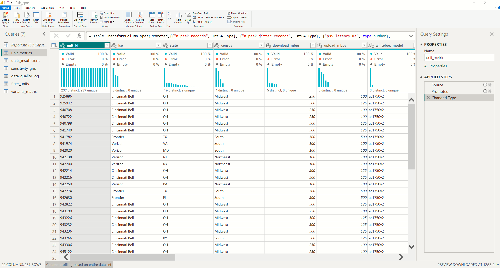

*Figure 1. `unit_metrics` after load: 237 rows, 20 columns, no errors, column profiling based on the entire data set.*

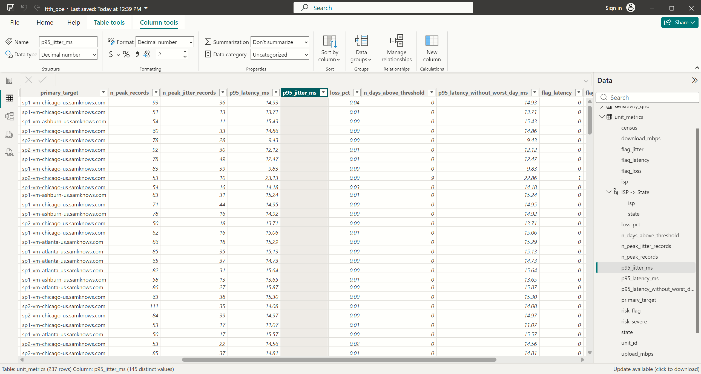

*Figure 2. Null `p95_jitter_ms` is preserved as blank (D-07). No default aggregation (Σ) on the metric columns.*

## 4. Session 2 - Model (Model the data)

| # | Step | Why |
| :-: | :--- | :--- |
| 1 | *Autodetect new relationships* disabled (Current File > Data Load) | `unit_metrics` and `units_insufficient` are disjoint sets of the same population; an automatic `unit_id` relationship would be wrong. |
| 2 | Close & Apply (Import mode) | Copies data into the in-memory engine used by DAX. |
| 3 | Model view checked: 0 relationships | Confirms the flat design. |
| 4 | *Don't summarize* on identifiers, flags, counts and all `p95_*`, `loss_pct`, `n_days_above_threshold` columns | Default SUM of a per-unit P95 is meaningless. Aggregations will be explicit measures. |
| 5 | `loss_pct` formatted as decimal, not as percentage | It is already in percentage points (0.04 = 0.04 %). The % format would multiply by 100. |
| 6 | Hierarchy `ISP -> State` in `unit_metrics` (right-click `isp` > Create hierarchy, then `state` > Add to hierarchy) | Drill-down without a dimension table. General level first (ISP), specific second (State). The first attempt produced a one-level hierarchy (only `state`), so drill up/down was disabled; the Matrix test (step 8) exposed it and the hierarchy was rebuilt with both levels. |
| 7 | Table descriptions added in Model view | Keeps the modelling notes inside the file. |
| 8 | Hierarchy test with a Matrix visual (`ISP -> State` in rows, count of `unit_id` in values, expanded one level) | Confirms the hierarchy drills ISP -> State and that the grand total equals the 237 analyzed units. |

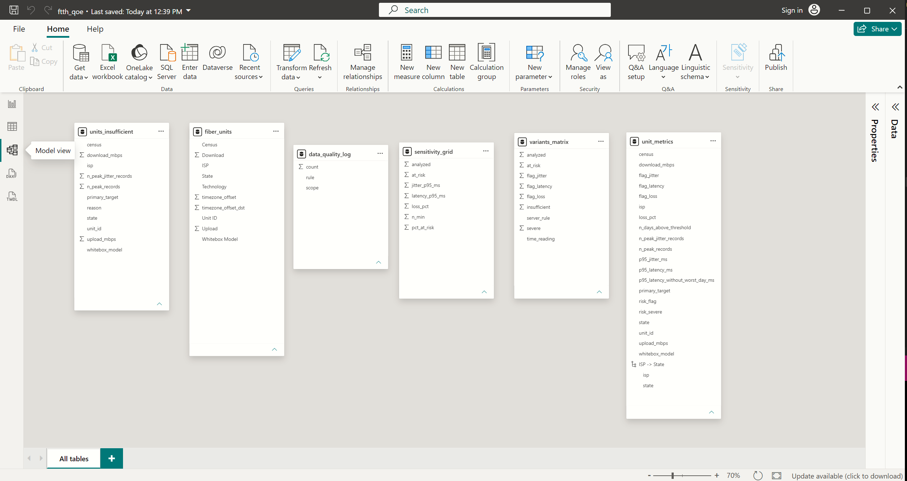

*Figure 3. Flat model: six tables and zero relationships; `ISP -> State` hierarchy in `unit_metrics`.*

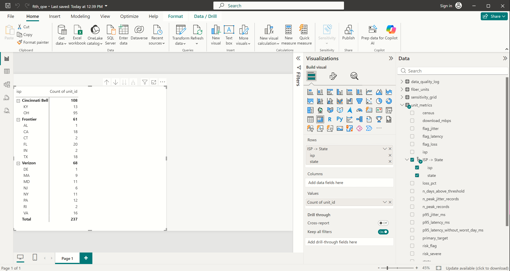

*Figure 4. Hierarchy check: ISP level expands into states; the grand total equals 237.*

**Hierarchy check results (analyzed units per ISP)**

| ISP | Population (`fiber_units`) | Insufficient | Analyzed (Matrix) | States |
| :--- | :-: | :-: | :-: | :--- |
| Cincinnati Bell | 120 | 12 | 108 | KY 13, OH 95 |
| Frontier | 62 | 1 | 61 | AL 1, CA 18, CT 2, FL 20, IN 2, TX 18 |
| Verizon | 76 | 8 | 68 | DE 1, MA 9, MD 11, NJ 6, NY 11, PA 12, RI 2, VA 16 |
| **Total** | **258** | **21** | **237** | 16 states |

Analyzed + insufficient = population for every ISP, and the grand total matches the 237 units of `unit_metrics`. Ohio holds 95 of the 237 analyzed units (40 %), a geographic concentration to mention in the findings.

## 5. Session 3 - Base measures (Model the data)

All KPIs are DAX **measures** stored in an empty container table, `_Measures` (created with *Enter data*, placeholder column hidden). The table has no relationships, so the model stays flat.

**Why measures and not calculated columns.** A calculated column is evaluated once per row at load time and stored; a measure is evaluated when a visual is drawn, in the current filter context, so it reacts to slicers, rows and drill-down. The per-unit metrics are already computed by `src/pipeline.py`; Power BI only aggregates them.

| # | Step | Why |
| :-: | :--- | :--- |
| 1 | Create `_Measures` (Home > Enter data > Create/Load) | One home for every KPI; keeps the field list organized. |
| 2 | Create the 11 measures below (Home > New measure) | Counts, rates and data-quality indicators used in all report pages. |
| 3 | Format: integers with thousands separator; `% Analyzed` and `% At Risk` as percentage with 1 decimal | `% At Risk` showed `0` until it was formatted as a percentage (5 / 237 = 0.0211). A format issue, not a calculation error. |
| 4 | Display folders (Model view > Properties > Display folder): `1 Population`, `2 Risk`, `3 Data Quality` | Readable field list. |
| 5 | `COALESCE(..., 0)` on count measures that can be empty | `COUNTROWS` returns BLANK when no row passes the filter. A KPI card should say 0, not blank. |

```dax
-- 1 Population
Analyzed Units = COUNTROWS ( unit_metrics )

Insufficient Units =
CALCULATE (
    COUNTROWS ( units_insufficient ),
    -- no relationships: pass the ISP and state filters to the other table by hand
    TREATAS ( VALUES ( unit_metrics[isp] ),   units_insufficient[isp] ),
    TREATAS ( VALUES ( unit_metrics[state] ), units_insufficient[state] )
)

Population Units = [Analyzed Units] + [Insufficient Units]
% Analyzed       = DIVIDE ( [Analyzed Units], [Population Units] )

-- 2 Risk
At Risk Units = COALESCE ( CALCULATE ( COUNTROWS ( unit_metrics ), unit_metrics[risk_flag] = 1 ), 0 )
Severe Units  = COALESCE ( CALCULATE ( COUNTROWS ( unit_metrics ), unit_metrics[risk_severe] = 1 ), 0 )
% At Risk     = DIVIDE ( [At Risk Units], [Analyzed Units] )
Latency Flags = COALESCE ( CALCULATE ( COUNTROWS ( unit_metrics ), unit_metrics[flag_latency] = 1 ), 0 )
Jitter Flags  = COALESCE ( CALCULATE ( COUNTROWS ( unit_metrics ), unit_metrics[flag_jitter] = 1 ), 0 )
Loss Flags    = COALESCE ( CALCULATE ( COUNTROWS ( unit_metrics ), unit_metrics[flag_loss] = 1 ), 0 )

-- 3 Data quality
Units Null Jitter = COUNTROWS ( unit_metrics ) - COUNT ( unit_metrics[p95_jitter_ms] )
```

- `COUNTROWS` counts rows (units); `COUNT` counts non-blank values, so `Units Null Jitter` = 237 - 144 = 93 without altering the nulls (D-07).
- `DIVIDE` returns blank instead of an error when the denominator is 0.
- The denominator of `% At Risk` is the analyzed units (5 / 237 = 2.1 %), as in the base case of the pipeline.

**Verification against the pipeline reference (no filters)**

| Measure | Expected | Observed |
| :--- | :-: | :-: |
| Analyzed / Insufficient / Population | 237 / 21 / 258 | 237 / 21 / 258 |
| % Analyzed | 91.9 % | 91.9 % |
| At Risk / Severe | 5 / 1 | 5 / 1 |
| % At Risk | 2.1 % | 2.1 % |
| Latency / Jitter / Loss Flags | 5 / 0 / 1 | 5 / 0 / 1 |
| Units Null Jitter | 93 | 93 |

`Insufficient Units` is the delicate measure, because it relies on `TREATAS`. It was checked at ISP and state level: the states with insufficient units are KY 1, OH 11, TX 1, MA 2, NJ 2, PA 1 and VA 3 (total 21), and analyzed + insufficient = population in every ISP and state (Cincinnati Bell 108 + 12 = 120, Frontier 61 + 1 = 62, Verizon 68 + 8 = 76).

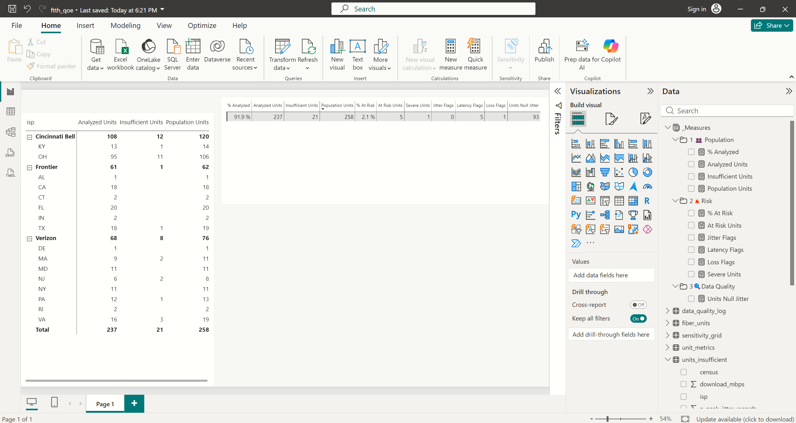

*Figure 5. Measure totals (table) and `Analyzed`, `Insufficient` and `Population` units by ISP and state (matrix).*

Selecting a row in the Matrix cross-filters the other visuals (for example, selecting FL shows 20 analyzed units, 0 at risk, 1 unit with null jitter). Clear the selection before reading grand totals.

## 6. Session 4A - Audit of latency cleaning (Prepare the data)

**Goal.** Rebuild the latency cleaning of the pipeline (period, validity, duplicates D-05) in Power Query, independently of `src/pipeline.py`, and reconcile the row counts with the pipeline data-quality log.

**Source and its limits.** The audit reads `data/interim/udplatency_ftth.csv`, the output of `step_1.py`. That folder is gitignored, so the audit is reproducible only locally or after re-running `step_1.py`. Because the input is the pipeline's own interim file, this audit does not cover step 1 itself (the 258-unit filter is covered by the test suite). Minor discrepancies against the pipeline are expected and are reported per `Unit ID`, never hidden in totals.

**Query design.** Each stage is its own query referencing the previous one, so the row count of every stage can be read and audited. All staging queries have *Enable load* off; only `aud_dq` is loaded.

| Query | Logic | Loaded |
| :--- | :--- | :-: |
| `aud_lat_raw` | CSV read (UTF-8), headers promoted, explicit types with culture `en-US` | No |
| `aud_lat_period` | `dtime` in [2022-09-12, 2022-11-01) (D-01) | No |
| `aud_lat_valid` | `rtt_avg` not null and >= 0, `successes + failures` > 0 | No |
| `aud_lat_distinct` | `Table.Distinct` on all columns (exact duplicates, D-05) | No |
| `aud_lat_conflicts` | groups of (`unit_id`, `dtime`, `target`) with more than 1 row after exact dedup | No |
| `aud_lat_clean` | `aud_lat_distinct` minus conflicting keys (Left Anti join) | No |
| `aud_dq` | `Table.RowCount` of each stage | Yes |

**Why this order and these tools.**
- Exact duplicates are removed first on all columns. Conflicting duplicates (same key, different values) are then dropped entirely with an anti-join (D-05).
- Remove Duplicates on the three key columns alone would be wrong: it would keep one row of each conflicting group instead of dropping all of them.
- Exact counts come from `Table.RowCount`; the preview shows "999+" for large tables and column profiling defaults to the top 1000 rows (switch it to the entire data set when profiling).

**Verification.**

| Stage | Pipeline log | `aud_dq` |
| :--- | :-: | :-: |
| rows_read | 172,800 | 172,800 |
| rows_in_analysis_period | 172,800 | 172,800 |
| rows_valid | 172,800 | 172,800 |
| rows_after_exact_dedup | 172,791 | 172,791 |
| duplicate_conflicting_groups | 0 | 0 |
| rows_after_cleaning | 172,791 | 172,791 |

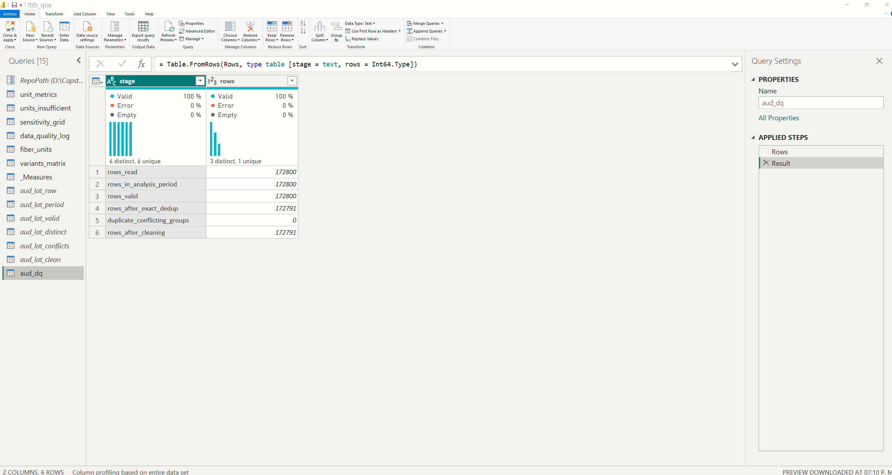

*Figure 6. `aud_dq` row counts per stage (staging queries in italics are not loaded).*

**Result.** Power Query reproduces the pipeline cleaning for latency: 9 exact extra rows and 0 conflicting groups. Jitter (4 exact extras, 1 conflicting group, unit 943232) is audited in session 5.

## 7. Session 4B - Audit of peak window, primary server, P95 latency and loss (Prepare the data)

**Goal.** Rebuild the per-unit core metrics of the pipeline (peak window D-03, primary server D-04/D-06, minimum records D-02, P95 latency, loss, flags) in Power Query, starting from `aud_lat_clean`, and check totals and two control units. The per-unit reconciliation against `ftth_qoe_unit_metrics.csv` is done in session 7, once jitter and D-10 columns also exist.

### 7.1 Audit parameters

Created inside the Power Query Editor (*Home > Manage Parameters > New Parameter*), as for `RepoPath`. The parameter dialog has no *Whole Number* type, so `N_MIN` is a *Decimal Number*; comparing an integer column with it works the same in M. *Required* stays checked.

| Parameter | Type | Value | Description |
| :--- | :--- | :-: | :--- |
| `N_MIN` | Decimal Number | 50 | Minimum peak-window latency records required for a unit to be analyzed (D-02). Below it, the unit is "insufficient". Mirrors `n_min_peak_records` in `config.yaml`. |
| `THR_LATENCY_MS` | Decimal Number | 20 | P95 latency threshold in ms during the peak window. A unit is flagged when P95 is strictly greater. Mirrors the latency threshold in `config.yaml`. |
| `THR_LOSS_PCT` | Decimal Number | 1 | Packet loss threshold in percent on the primary server's peak records. A unit is flagged when loss is strictly greater. Mirrors the loss threshold in `config.yaml`. |

*Why parameters.* Thresholds live in one place and can change without editing queries, as in the pipeline. They duplicate `config.yaml`, so a change there must be repeated here.

### 7.2 Queries

Each query is created with *Home > New Source > Blank Query*, renamed in *Query Settings*, and its code pasted in the *Advanced Editor*. The order matters because each query references the previous one.

| Query | Purpose | Loaded |
| :--- | :--- | :-: |
| `aud_lat_peak` | Peak window 19:00-22:59 (D-03) | No |
| `aud_primary` | Primary server per unit (D-04, D-06) | No |
| `aud_lat_metrics` | Records, P95 latency and loss on the primary server | No |
| `aud_core` | Status (analyzed / insufficient) and flags per unit | Yes (until session 5B, see 8.2) |

**`aud_lat_peak`**
```m
let
    Source = aud_lat_clean,
    // dtime is already local time (D-03); window 19:00-22:59 => hour >= 19 and < 23
    Result = Table.SelectRows(Source, each Time.Hour([dtime]) >= 19 and Time.Hour([dtime]) < 23)
in
    Result
```

**`aud_primary`**
```m
let
    // peak records per unit and server
    Counts = Table.Group(aud_lat_peak, {"unit_id", "target"},
        {{"n", each Table.RowCount(_), Int64.Type}}),
    // per unit: most records first; tie => alphabetical target
    Result = Table.Group(Counts, {"unit_id"}, {{"primary_target",
        each Table.Sort(_, {{"n", Order.Descending}, {"target", Order.Ascending}}){0}[target],
        type text}})
in
    Result
```
The primary server is chosen once per unit using peak latency records (D-06). Sorting and taking the first row keeps the alphabetical tie-break; `Table.Distinct` would not guarantee it.

**`aud_lat_metrics`**
```m
let
    // keep only the records of each unit's primary server
    Joined = Table.NestedJoin(aud_lat_peak, {"unit_id", "target"},
        aud_primary, {"unit_id", "primary_target"}, "p", JoinKind.Inner),
    OnPrimary = Table.RemoveColumns(Joined, {"p"}),
    WithMs = Table.AddColumn(OnPrimary, "lat_ms", each [rtt_avg] / 1000, type number),  // us -> ms
    Result = Table.Group(WithMs, {"unit_id"}, {
        {"n_peak_records", each Table.RowCount(_), Int64.Type},
        // ExcelInc = PERCENTILE.INC = pandas linear interpolation; set explicitly
        {"p95_latency_ms", each List.Percentile([lat_ms], 0.95,
            [PercentileMode = PercentileMode.ExcelInc]), type number},
        // ratio of sums, not an average of per-row percentages
        {"loss_pct", each List.Sum([failures]) / (List.Sum([successes]) + List.Sum([failures])) * 100, type number}
    })
in
    Result
```
`PercentileMode.ExcelInc` is set on purpose: M's default percentile mode is not the interpolation used by pandas.

**`aud_core`**
```m
let
    Joined = Table.NestedJoin(aud_lat_metrics, {"unit_id"}, aud_primary, {"unit_id"}, "p", JoinKind.Inner),
    WithTarget = Table.ExpandTableColumn(Joined, "p", {"primary_target"}),
    WithStatus = Table.AddColumn(WithTarget, "status",
        each if [n_peak_records] >= N_MIN then "analyzed" else "insufficient", type text),
    // strictly greater than the threshold (spec)
    FlagLat = Table.AddColumn(WithStatus, "flag_latency",
        each if [p95_latency_ms] > THR_LATENCY_MS then 1 else 0, Int64.Type),
    Result = Table.AddColumn(FlagLat, "flag_loss",
        each if [loss_pct] > THR_LOSS_PCT then 1 else 0, Int64.Type)
in
    Result
```

### 7.3 Load and model hygiene

- *Enable load* is off for `aud_lat_peak`, `aud_primary` and `aud_lat_metrics`; only `aud_core` (258 rows) and `aud_dq` are loaded.
- In the Data view, `unit_id`, `n_peak_records`, `p95_latency_ms`, `loss_pct`, `flag_latency` and `flag_loss` of `aud_core` are set to *Summarization: Don't summarize*, so a P95 is never summed by accident.

### 7.4 Verification

Totals and control units were checked with the *DAX query view* (queries are saved in the `.pbix` and are not published). No measures were added to the model.

```dax
EVALUATE
ROW (
    "rows",          COUNTROWS ( aud_core ),
    "analyzed",      CALCULATE ( COUNTROWS ( aud_core ), aud_core[status] = "analyzed" ),
    "insufficient",  CALCULATE ( COUNTROWS ( aud_core ), aud_core[status] = "insufficient" ),
    "flag_latency",  CALCULATE ( SUM ( aud_core[flag_latency] ), aud_core[status] = "analyzed" ),
    "flag_loss",     CALCULATE ( SUM ( aud_core[flag_loss] ), aud_core[status] = "analyzed" )
)
```

| Control | Pipeline reference | `aud_core` |
| :--- | :-: | :-: |
| Units | 258 | 258 |
| Analyzed / insufficient | 237 / 21 | 237 / 21 |
| Latency flags (analyzed) | 5 | 5 |
| Loss flags (analyzed) | 1 | 1 |
| Unit 925942 | `sp1-vm-chicago-us.samknows.com`, 93 records, P95 14.93, loss 0.04 | same |
| Unit 943226 | `sp2-vm-chicago-us.samknows.com`, 53 records, P95 23.13, loss 0.00, latency flag | same |

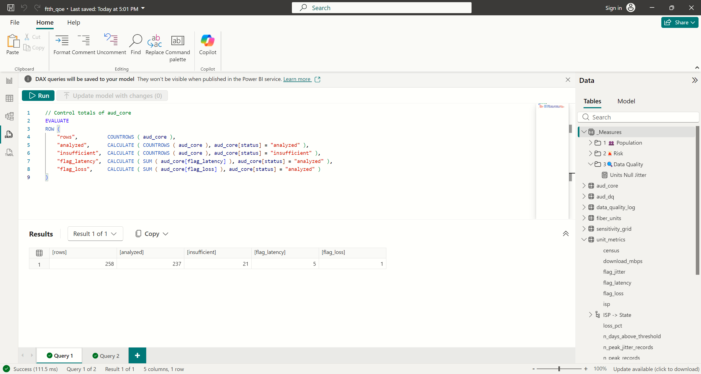

*Figure 7. Totals of `aud_core`: 258 units, 237 analyzed, 21 insufficient, 5 latency flags, 1 loss flag.*

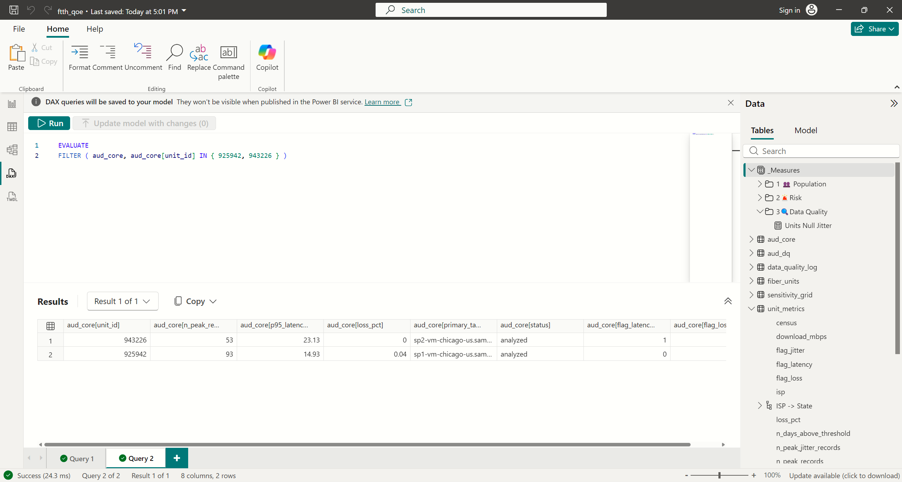

*Figure 8. Control units 925942 and 943226.*

The threshold edge also behaves as specified: a unit with 49 peak records is `insufficient`, a unit with exactly 50 is `analyzed` (`>= N_MIN`).

**Result.** Power Query reproduces the pipeline totals and both control units. Per-unit differences, if any, are reported in session 7.

## 8. Session 5 - Audit of jitter (Prepare the data)

### 8.1 Session 5A - Jitter cleaning

**Goal.** Rebuild the jitter cleaning of the pipeline (period, validity, duplicates D-05) from `data/interim/udpjitter_ftth.csv`, with the same staging design as 4A, and reconcile the row counts with the pipeline data-quality log. The same limits apply: the file is the output of `step_1.py`, the folder is gitignored, and step 1 itself is not audited.

**Differences from latency.**
- Validity rule: `jitter_up` and `jitter_down` must both be non-null and >= 0 (the latency rules on `rtt_avg`, successes and failures do not apply).
- Unlike latency, jitter has one conflicting duplicate group (same key, different values), so `aud_jit_conflicts` is not empty.

| Query | Logic | Loaded |
| :--- | :--- | :-: |
| `aud_jit_raw` | CSV read (UTF-8), headers promoted, explicit types with culture `en-US` | No |
| `aud_jit_period` | `dtime` in [2022-09-12, 2022-11-01) (D-01) | No |
| `aud_jit_valid` | jitter up and down not null and >= 0 | No |
| `aud_jit_distinct` | `Table.Distinct` on all columns (exact duplicates, D-05) | No |
| `aud_jit_conflicts` | keys (`unit_id`, `dtime`, `target`) with more than 1 row after exact dedup | No |
| `aud_jit_clean` | `aud_jit_distinct` minus conflicting keys (Left Anti join) | No |
| `aud_dq_jit` | `Table.RowCount` of each stage | Yes |

`aud_dq_jit` is a separate query instead of an extension of `aud_dq`, so the verified latency audit is not modified.

**`aud_jit_raw`**
```m
let
    Source = Csv.Document(File.Contents(RepoPath & "data\interim\udpjitter_ftth.csv"),
        [Delimiter = ",", Encoding = 65001, QuoteStyle = QuoteStyle.Csv]),
    Promoted = Table.PromoteHeaders(Source, [PromoteAllScalars = true]),
    Result = Table.TransformColumnTypes(Promoted, {
        {"unit_id", Int64.Type}, {"dtime", type datetime}, {"target", type text},
        {"jitter_up", type number}, {"jitter_down", type number}}, "en-US")
in
    Result
```

**`aud_jit_period`**
```m
let
    Source = aud_jit_raw,
    Result = Table.SelectRows(Source, each [dtime] >= #datetime(2022,9,12,0,0,0) and [dtime] < #datetime(2022,11,1,0,0,0))
in
    Result
```

**`aud_jit_valid`**
```m
let
    Source = aud_jit_period,
    // invalid: null or negative jitter in either direction
    Result = Table.SelectRows(Source, each [jitter_up] <> null and [jitter_down] <> null and [jitter_up] >= 0 and [jitter_down] >= 0)
in
    Result
```

**`aud_jit_distinct`**
```m
let
    Source = aud_jit_valid,
    // exact duplicates only: all columns must match (D-05)
    Result = Table.Distinct(Source)
in
    Result
```

**`aud_jit_conflicts`**
```m
let
    Source = aud_jit_distinct,
    Grouped = Table.Group(Source, {"unit_id", "dtime", "target"}, {{"n", each Table.RowCount(_), Int64.Type}}),
    Result = Table.SelectRows(Grouped, each [n] > 1)
in
    Result
```

**`aud_jit_clean`**
```m
let
    Keys = {"unit_id", "dtime", "target"},
    Joined = Table.NestedJoin(aud_jit_distinct, Keys, aud_jit_conflicts, Keys, "conf", JoinKind.LeftAnti),
    Result = Table.RemoveColumns(Joined, {"conf"})
in
    Result
```

**`aud_dq_jit`**
```m
let
    Rows = {
        {"rows_read", Table.RowCount(aud_jit_raw)},
        {"rows_in_analysis_period", Table.RowCount(aud_jit_period)},
        {"rows_valid", Table.RowCount(aud_jit_valid)},
        {"rows_after_exact_dedup", Table.RowCount(aud_jit_distinct)},
        {"duplicate_conflicting_groups", Table.RowCount(aud_jit_conflicts)},
        {"rows_after_cleaning", Table.RowCount(aud_jit_clean)}
    },
    Result = Table.FromRows(Rows, type table [stage = text, rows = Int64.Type])
in
    Result
```

**Verification.**

| Stage | Pipeline log | `aud_dq_jit` |
| :--- | :-: | :-: |
| rows_read / in period / valid | 152,730 | 152,730 |
| rows_after_exact_dedup | 152,726 | 152,726 |
| duplicate_conflicting_groups | 1 | 1 |
| rows_after_cleaning | 152,724 | 152,724 |

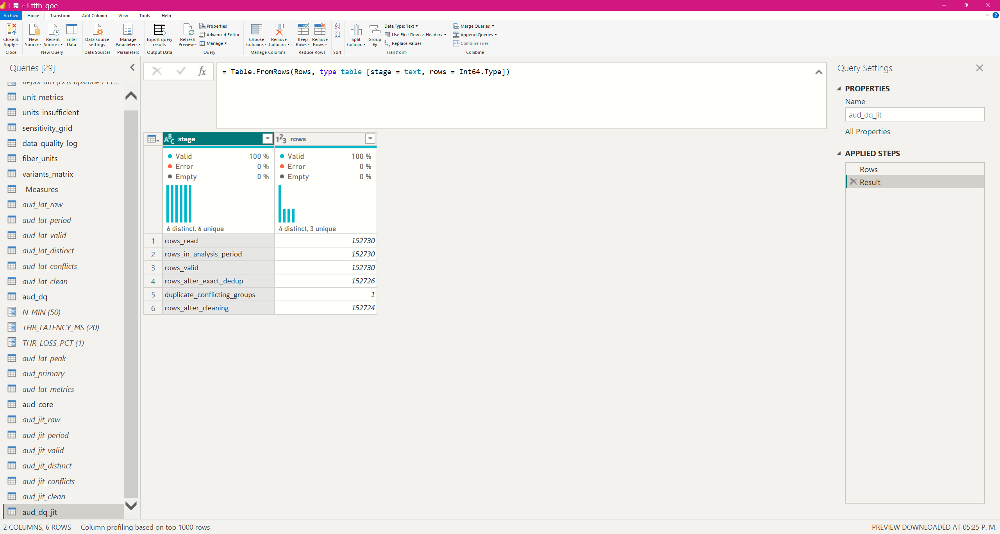

*Figure 9. `aud_dq_jit` row counts per stage (staging queries in italics are not loaded).*

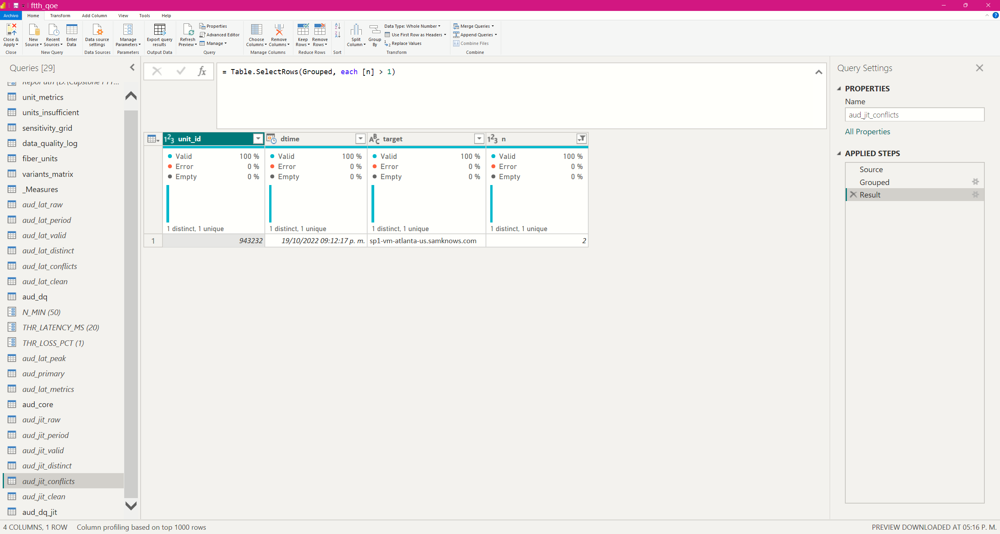

*Figure 10. The only conflicting group: unit 943232, server `sp1-vm-atlanta-us.samknows.com`, 2022-10-19 21:12:17, 2 rows.*

**Result.** Power Query reproduces the pipeline cleaning for jitter: 4 exact extra rows, 1 conflicting group and 2 rows dropped (152,726 - 2 = 152,724). The conflicting pair falls inside the peak window (hour 21), so Power BI and the pipeline drop it at the same point.

### 8.2 Session 5B - P95 jitter and minimum-records rule (D-06, D-07)

**Goal.** Compute the per-unit jitter metrics on the primary server of the latency file and apply the minimum of peak jitter records.

**Parameters** (created as in 7.1, type Decimal Number):

| Parameter | Value | Description |
| :--- | :-: | :--- |
| `N_JIT_MIN` | 50 | Minimum peak-window jitter records on the primary server required to report P95 jitter (D-07). Below it, jitter is null, never 0. Mirrors `metrics.jitter.min_peak_records` in `config.yaml`. |
| `THR_JITTER_MS` | 5 | P95 jitter threshold in ms during the peak window. A unit is flagged when P95 is strictly greater. Mirrors the jitter threshold in `config.yaml`. |

`N_JIT_MIN` is separate from `N_MIN` because the configuration keeps them as independent rules, although both are 50 today.

**`aud_jit_metrics`**
```m
let
    // jitter peak window (D-03), same hours as latency
    Peak = Table.SelectRows(aud_jit_clean, each Time.Hour([dtime]) >= 19 and Time.Hour([dtime]) < 23),
    // D-06: only the primary server chosen from the LATENCY file
    Joined = Table.NestedJoin(Peak, {"unit_id", "target"}, aud_primary, {"unit_id", "primary_target"}, "p", JoinKind.Inner),
    OnPrimary = Table.RemoveColumns(Joined, {"p"}),
    // jitter_up / jitter_down in us -> average -> ms
    WithMs = Table.AddColumn(OnPrimary, "jit_ms", each ([jitter_up] + [jitter_down]) / 2 / 1000, type number),
    Result = Table.Group(WithMs, {"unit_id"}, {
        {"n_peak_jitter_records", each Table.RowCount(_), Int64.Type},
        {"p95_jitter_raw", each List.Percentile([jit_ms], 0.95, [PercentileMode = PercentileMode.ExcelInc]), type number}
    })
in
    Result
```
The primary server comes from the latency file (D-06); the jitter file does not get its own. `p95_jitter_raw` does not apply the minimum yet; that rule is a visible step in `aud_units`.

**`aud_units`**
```m
let
    // left join: units without jitter records on the primary server must stay
    Joined = Table.NestedJoin(aud_core, {"unit_id"}, aud_jit_metrics, {"unit_id"}, "j", JoinKind.LeftOuter),
    Expanded = Table.ExpandTableColumn(Joined, "j", {"n_peak_jitter_records", "p95_jitter_raw"}),
    // a count with no records is a real 0
    Counts = Table.ReplaceValue(Expanded, null, 0, Replacer.ReplaceValue, {"n_peak_jitter_records"}),
    // D-07: P95 only with enough records, otherwise null (never 0)
    P95 = Table.AddColumn(Counts, "p95_jitter_ms",
        each if [n_peak_jitter_records] >= N_JIT_MIN then [p95_jitter_raw] else null, type nullable number),
    // null never raises a flag; the guard is needed because null > 5 returns null in M
    Flag = Table.AddColumn(P95, "flag_jitter",
        each if [p95_jitter_ms] <> null and [p95_jitter_ms] > THR_JITTER_MS then 1 else 0, Int64.Type),
    Result = Table.RemoveColumns(Flag, {"p95_jitter_raw"})
in
    Result
```

**Load.** `aud_jit_metrics` and `aud_core` have *Enable load* off (`aud_units` contains `aud_core`). `aud_units` is loaded (258 rows) and its numeric columns are set to *Don't summarize*. Figures 7 and 8 were taken when `aud_core` was loaded; `aud_units` was the audit table until session 6, where `aud_unit_metrics` supersedes it and `aud_units` stops being loaded.

**Verification (DAX query view).**
```dax
EVALUATE
ROW (
    "rows",        COUNTROWS ( aud_units ),
    "null_jitter", CALCULATE ( COUNTROWS ( aud_units ), aud_units[status] = "analyzed", aud_units[p95_jitter_ms] = BLANK () ),
    "flag_jitter", CALCULATE ( SUM ( aud_units[flag_jitter] ), aud_units[status] = "analyzed" )
)
```

| Control | Pipeline reference | `aud_units` |
| :--- | :-: | :-: |
| Units | 258 | 258 |
| Analyzed units with null jitter | 93 | 93 |
| Jitter flags (analyzed) | 0 | 0 |
| Unit 925942 | 36 peak jitter records, null P95 | 36, null |
| Unit 925886 | 68 records, P95 0.3562 | 68, 0.36 |

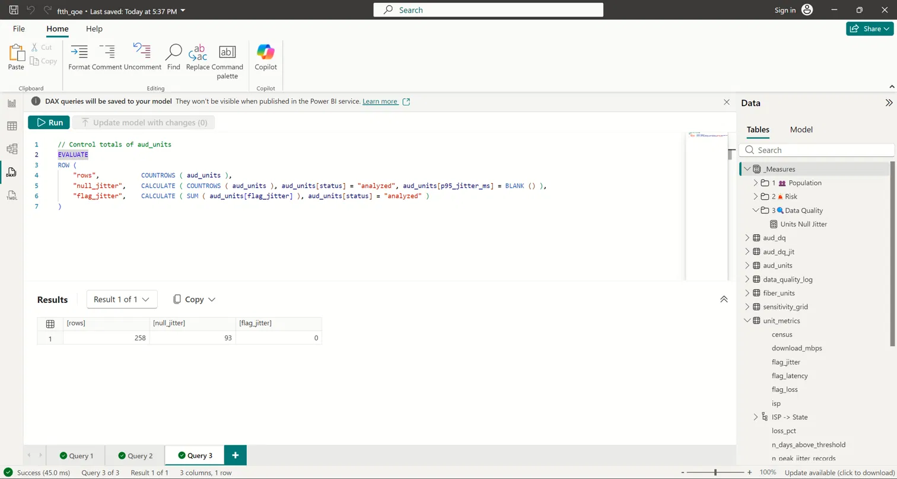

*Figure 11. Totals of `aud_units`: 258 units, 93 analyzed units with null jitter, 0 jitter flags.*

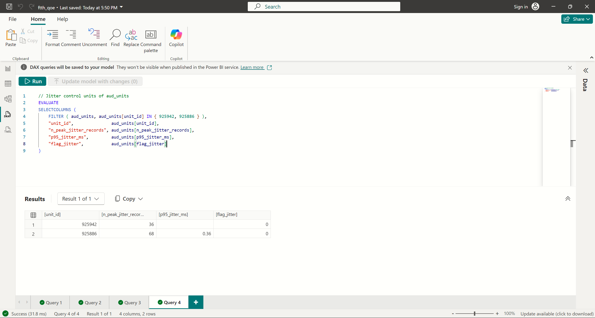

*Figure 12. Control units 925942 (below the minimum, null jitter) and 925886 (P95 0.36 ms).*

**Result.** Power Query reproduces the jitter rule of the pipeline: null below 50 peak jitter records, never 0, and no jitter flag in the base case (D-07, D-09). Per-unit differences, if any, are reported in session 7.

## 9. Session 6 - Risk flags, severity and D-10 columns (Prepare the data)

**Goal.** Complete the per-unit audit table with `risk_flag`, `risk_severe` and the two D-10 descriptive columns, so that it has the same columns as `ftth_qoe_unit_metrics.csv` and can be reconciled in session 7. D-10 does not change the risk rule: a latency flag stays a flag even when one episode causes it; the columns only let the report separate persistent from episodic flags.

### 9.1 Severe-threshold parameters

Decimal Number, created as in 7.1.

| Parameter | Value | Description |
| :--- | :-: | :--- |
| `THR_LATENCY_SEV_MS` | 50 | Severe P95 latency threshold in ms. A unit is severe when P95 is strictly greater. Mirrors `thresholds.severe.latency_p95_ms` in `config.yaml`. |
| `THR_JITTER_SEV_MS` | 15 | Severe P95 jitter threshold in ms. Null jitter never makes a unit severe. Mirrors `thresholds.severe.jitter_p95_ms` in `config.yaml`. |
| `THR_LOSS_SEV_PCT` | 10 | Severe packet loss threshold in percent. Mirrors `thresholds.severe.loss_pct` in `config.yaml`. |

### 9.2 Queries

| Query | Purpose | Loaded |
| :--- | :--- | :-: |
| `aud_lat_rows` | Peak records of each unit's primary server, with `lat_ms` and local `day` | No |
| `aud_d10` | D-10 columns per unit | No |
| `aud_unit_metrics` | Final audit table: `aud_units` + D-10 + `risk_flag` + `risk_severe` | Yes |

**`aud_lat_rows`**
```m
let
    Joined = Table.NestedJoin(aud_lat_peak, {"unit_id", "target"}, aud_primary, {"unit_id", "primary_target"}, "p", JoinKind.Inner),
    OnPrimary = Table.RemoveColumns(Joined, {"p"}),
    WithMs = Table.AddColumn(OnPrimary, "lat_ms", each [rtt_avg] / 1000, type number),
    // day = local date of the record (dtime is already local time, D-03)
    Result = Table.AddColumn(WithMs, "day", each Date.From([dtime]), type date)
in
    Result
```
D-10 needs the individual records per day, which `aud_lat_metrics` already aggregates. The logic of the primary-server join is repeated on purpose so the verified query is not modified.

**`aud_d10`**
```m
let
    P95 = (values as list) as nullable number =>
        if List.Count(values) = 0 then null
        else List.Percentile(values, 0.95, [PercentileMode = PercentileMode.ExcelInc]),
    // D-10: P95 after removing the date with most records above the threshold (ties: earliest date)
    WithoutWorstDay = (t as table) as nullable number =>
        let
            Above = Table.SelectRows(t, each [lat_ms] > THR_LATENCY_MS),
            PerDay = Table.Group(Above, {"day"}, {{"n", each Table.RowCount(_), Int64.Type}}),
            MaxN = List.Max(PerDay[n]),
            Worst = List.Min(Table.SelectRows(PerDay, each [n] = MaxN)[day]),
            Rest = Table.SelectRows(t, each [day] <> Worst)
        in
            // no record above the threshold => equals the plain P95
            if Table.RowCount(Above) = 0 then P95(t[lat_ms]) else P95(Rest[lat_ms]),
    Result = Table.Group(aud_lat_rows, {"unit_id"}, {
        {"n_days_above_threshold", each List.Count(List.Distinct(Table.SelectRows(_, each [lat_ms] > THR_LATENCY_MS)[day])), Int64.Type},
        {"p95_latency_without_worst_day_ms", each WithoutWorstDay(_), type nullable number}
    })
in
    Result
```
The tie-break "earliest date" is `List.Min` over the tied dates. The two helper functions keep the `Table.Group` readable and avoid repeating the percentile call.

**`aud_unit_metrics`**
```m
let
    Joined = Table.NestedJoin(aud_units, {"unit_id"}, aud_d10, {"unit_id"}, "d", JoinKind.LeftOuter),
    Expanded = Table.ExpandTableColumn(Joined, "d", {"n_days_above_threshold", "p95_latency_without_worst_day_ms"}),
    // risk_flag: any of the three base flags
    RiskFlag = Table.AddColumn(Expanded, "risk_flag",
        each if [flag_latency] + [flag_jitter] + [flag_loss] > 0 then 1 else 0, Int64.Type),
    // severe: strictly greater than the severe thresholds; null jitter never raises it
    Result = Table.AddColumn(RiskFlag, "risk_severe",
        each if [p95_latency_ms] > THR_LATENCY_SEV_MS
                or ([p95_jitter_ms] <> null and [p95_jitter_ms] > THR_JITTER_SEV_MS)
                or [loss_pct] > THR_LOSS_SEV_PCT then 1 else 0, Int64.Type)
in
    Result
```
The null guard on jitter is required because `null > 15` returns `null` in M, not `false`.

### 9.3 Load

*Enable load* is off for `aud_units`, `aud_lat_rows` and `aud_d10`. Only `aud_unit_metrics` (258 rows) is loaded, with its numeric columns set to *Don't summarize*.

### 9.4 Verification (DAX query view)

```dax
// Control totals of aud_unit_metrics
EVALUATE
ROW (
    "rows",       COUNTROWS ( aud_unit_metrics ),
    "at_risk",    CALCULATE ( COUNTROWS ( aud_unit_metrics ), aud_unit_metrics[status] = "analyzed", aud_unit_metrics[risk_flag] = 1 ),
    "severe",     CALCULATE ( COUNTROWS ( aud_unit_metrics ), aud_unit_metrics[status] = "analyzed", aud_unit_metrics[risk_severe] = 1 ),
    "persistent", CALCULATE ( COUNTROWS ( aud_unit_metrics ), aud_unit_metrics[status] = "analyzed", aud_unit_metrics[flag_latency] = 1, aud_unit_metrics[p95_latency_without_worst_day_ms] > 20 ),
    "episodic",   CALCULATE ( COUNTROWS ( aud_unit_metrics ), aud_unit_metrics[status] = "analyzed", aud_unit_metrics[flag_latency] = 1, aud_unit_metrics[p95_latency_without_worst_day_ms] <= 20 )
)
```

| Control | Pipeline reference | `aud_unit_metrics` |
| :--- | :-: | :-: |
| Units | 258 | 258 |
| At risk / severe (analyzed) | 5 / 1 | 5 / 1 |
| Persistent / episodic latency flags | 4 / 1 | 4 / 1 |

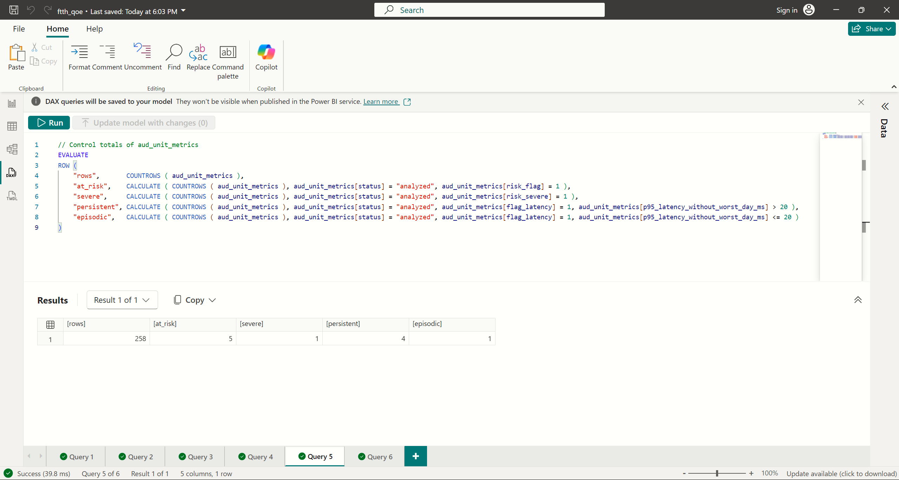

*Figure 13. Totals of `aud_unit_metrics`: 258 units, 5 at risk, 1 severe, 4 persistent and 1 episodic latency flags.*

Four control units were checked against the pipeline output:

| Unit | P95 latency | Days above threshold | P95 without worst day | Severe |
| :--- | :-: | :-: | :-: | :-: |
| 925942 | 14.93 | 0 | 14.93 (equals P95) | 0 |
| 24733221 | 23.96 | 7 | 22.73 | 0 |
| 4190285 | 50.00 | 1 | 14.77 | 1 |
| 24840041 | 35.80 | 16 | 35.61 | 0 |

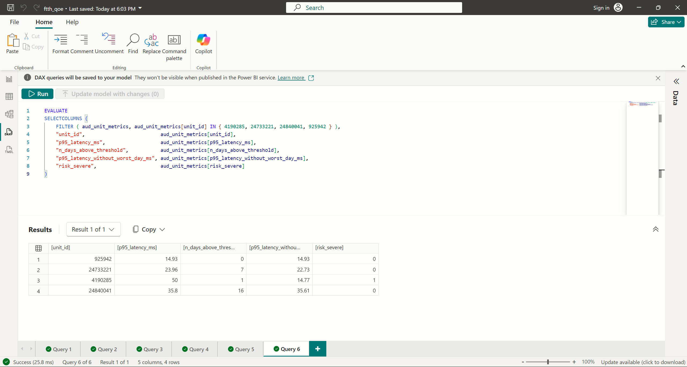

*Figure 14. D-10 control units.*

**Result.** Unit 4190285 is the episodic case: its P95 (50.0035 ms) is just above the severe threshold, and removing one day brings it to 14.77 ms. The other four flagged units stay above 20 ms without their worst day. Per-unit differences, if any, are reported in session 7.

## 10. Session 7 - Per-unit reconciliation (Analyze the data)

Session 7A reconciles the 237 analyzed units (sections 10.1 to 10.4); session 7B reconciles the 21 insufficient units (section 10.5). The result of both is summarized in `docs/reconciliation.md`.

### Session 7A - Analyzed units

**Goal.** Compare, unit by unit, the audit table built in Power Query (`aud_unit_metrics`) with the pipeline output (`unit_metrics`, loaded in session 1 from `data/processed/ftth_qoe_unit_metrics.csv`), as required by `docs/metrics_spec.md`, section 8. Reconciliation is never done by totals only: every unit is compared, and a difference would be analyzed one unit at a time (window, time convention, server rule, nulls).

### 10.1 Design

- **Reference table.** `unit_metrics` is already in the model; nothing new is loaded. It contains only the 237 analyzed units, so the audit side is filtered to `status = "analyzed"`.
- **Full outer join by `unit_id`.** Units present on one side only must appear in the result instead of disappearing, so the presence flags `in_audit` and `in_pipeline` are part of the output.
- **Tolerances** (spec section 8): +/- 0.001 for the three P95 columns (ms) and for `loss_pct` (percentage points); exact match for `n_peak_records`, `n_peak_jitter_records`, `n_days_above_threshold` and `risk_flag`. The audit also checks, with exact match, `primary_target`, `flag_latency`, `flag_jitter`, `flag_loss` and `risk_severe`, which is stricter than the specification.
- **Null jitter** matches only null jitter on the other side (same units with null jitter).
- **Tolerances in one table.** `rec_spec` holds the metric list and tolerances; `rec_units` and `rec_summary` read it, so nothing is repeated.

| Query | Purpose | Loaded |
| :--- | :--- | :-: |
| `rec_spec` | Metrics to reconcile and tolerance of each | No |
| `rec_units` | One row per unit: values from both sides, `ok_<metric>`, `diff_<metric>`, `n_mismatch` | Yes |
| `rec_summary` | One row per metric: units compared, mismatches, maximum absolute difference | Yes |

### 10.2 Queries

**`rec_spec`**
```m
// rec_spec: metrics to reconcile between the audit (aud_unit_metrics) and the pipeline output (unit_metrics)
// and the tolerance for each one (docs/metrics_spec.md, section 8). Single source of truth:
// rec_units and rec_summary both read this table, so tolerances are never repeated.
// tolerance 0 = exact match; > 0 = maximum absolute difference allowed.
let
    // columns: metric name, tolerance, origin of the rule
    Rows = {
        {"primary_target", 0, "exact (stricter than spec)"},
        {"n_peak_records", 0, "exact (spec section 8)"},
        {"n_peak_jitter_records", 0, "exact (spec section 8)"},
        {"p95_latency_ms", 0.001, "+/- 0.001 ms (spec section 8)"},
        {"p95_jitter_ms", 0.001, "+/- 0.001 ms (spec section 8)"},
        {"loss_pct", 0.001, "+/- 0.001 pp (spec section 8)"},
        {"n_days_above_threshold", 0, "exact (spec section 8)"},
        {"p95_latency_without_worst_day_ms", 0.001, "+/- 0.001 ms (spec section 8)"},
        {"flag_latency", 0, "exact (stricter than spec)"},
        {"flag_jitter", 0, "exact (stricter than spec)"},
        {"flag_loss", 0, "exact (stricter than spec)"},
        {"risk_flag", 0, "exact (spec section 8)"},
        {"risk_severe", 0, "exact (stricter than spec)"}
    },
    // explicit column types so downstream queries can rely on them
    Result = Table.FromRows(Rows, type table [metric = text, tolerance = number, rule = text])
in
    Result
```

**`rec_units`**
```m
// rec_units: per-unit reconciliation between the Power Query audit (aud_unit_metrics)
// and the pipeline output (unit_metrics = data/processed/ftth_qoe_unit_metrics.csv).
// One row per unit_id found on either side. For each metric in rec_spec it adds:
//   aud_<m> / pip_<m>  values from each side
//   ok_<m>             true when they match within the tolerance (null equals null only)
//   diff_<m>           absolute difference (null for text columns or when one side is null)
// n_mismatch counts the metrics that do not match. Differences are never fixed here:
// each one is analyzed by Unit ID (docs/metrics_spec.md, section 8, point 3).
let
    // metric list with tolerances; Table.ToRows gives one list per metric: {name, tolerance, rule}
    Spec = Table.ToRows(rec_spec),
    Cols = List.Transform(Spec, each _{0}),
    // audit side: analyzed units only, because the pipeline file contains only analyzed units.
    // Buffered so the join does not enumerate the audit chain more than once.
    AuditRows = Table.Buffer(Table.SelectRows(aud_unit_metrics, each [status] = "analyzed")),
    // prefix every column with its origin so both sides can live in the same row
    A = Table.RenameColumns(Table.SelectColumns(AuditRows, {"unit_id"} & Cols),
            List.Transform({"unit_id"} & Cols, each {_, "aud_" & _})),
    // unit_id is text in unit_metrics and integer in the audit; the join matches nothing unless both sides have the same type
    P0 = Table.TransformColumnTypes(Table.SelectColumns(unit_metrics, {"unit_id"} & Cols), {{"unit_id", Int64.Type}}, "en-US"),
    P = Table.RenameColumns(P0, List.Transform({"unit_id"} & Cols, each {_, "pip_" & _})),
    // full outer join: units present on one side only must show up instead of disappearing
    Joined0 = Table.NestedJoin(A, {"aud_unit_id"}, P, {"pip_unit_id"}, "p", JoinKind.FullOuter),
    Joined = Table.ExpandTableColumn(Joined0, "p", List.Transform({"unit_id"} & Cols, each "pip_" & _)),
    // single unit_id taken from whichever side has it
    WithId = Table.AddColumn(Joined, "unit_id",
        each if [aud_unit_id] <> null then [aud_unit_id] else [pip_unit_id], Int64.Type),
    // presence flags: show units that exist on one side only
    InAudit = Table.AddColumn(WithId, "in_audit", each [aud_unit_id] <> null, type logical),
    InPipeline = Table.AddColumn(InAudit, "in_pipeline", each [pip_unit_id] <> null, type logical),
    // match test: tolerance for numbers, plain equality for the rest.
    // If either side is null the result is a = b, so null matches only null (null jitter in the same units).
    Same = (a, b, tol) =>
        if a = null or b = null then a = b
        else if a is number and b is number then Number.Abs(a - b) <= tol
        else a = b,
    // absolute difference; try ... otherwise null covers text columns and nulls
    Diff = (a, b) => try Number.Abs(a - b) otherwise null,
    // List.Accumulate repeats the same step once per metric (adds the ok_ columns)
    Ok = List.Accumulate(Spec, InPipeline, (state, m) =>
        Table.AddColumn(state, "ok_" & m{0},
            each Same(Record.Field(_, "aud_" & m{0}), Record.Field(_, "pip_" & m{0}), m{1}), type logical)),
    // same pattern for the diff_ columns
    Diffs = List.Accumulate(Spec, Ok, (state, m) =>
        Table.AddColumn(state, "diff_" & m{0},
            each Diff(Record.Field(_, "aud_" & m{0}), Record.Field(_, "pip_" & m{0})), type nullable number)),
    // number of metrics that do not match in each unit (0 = unit fully reconciled)
    Result = Table.AddColumn(Diffs, "n_mismatch",
        each List.Count(List.Select(List.Transform(Cols, (c) => Record.Field(_, "ok_" & c)), each _ = false)), Int64.Type)
in
    Result
```

**`rec_summary`**
```m
// rec_summary: one row per reconciled metric.
//   units_compared  units present on both sides
//   mismatches      units outside the tolerance
//   max_abs_diff    largest absolute difference (null for text columns)
// It summarizes rec_units; reconciliation itself is judged unit by unit, never by these totals alone.
let
    // only units present on both sides are comparable; one-sided units are reported separately.
    // Table.Buffer evaluates rec_units once; without it every reference below re-reads the whole audit chain from the CSV.
    Both = Table.Buffer(Table.SelectRows(rec_units, each [in_audit] and [in_pipeline])),
    // one result row per metric listed in rec_spec
    Rows = List.Transform(Table.ToRows(rec_spec), (m) => {
        m{0},                                                                          // metric
        m{1},                                                                          // tolerance
        Table.RowCount(Both),                                                          // units compared
        Table.RowCount(Table.SelectRows(Both, each Record.Field(_, "ok_" & m{0}) = false)),  // mismatches
        List.Max(Table.Column(Both, "diff_" & m{0}))}),                                // max abs difference
    Result = Table.FromRows(Rows, type table [metric = text, tolerance = number,
        units_compared = Int64.Type, mismatches = Int64.Type, max_abs_diff = nullable number])
in
    Result
```

*Enable load* is off for `rec_spec`; `rec_units` and `rec_summary` are loaded.

### 10.3 Problems found and how they were resolved

| Symptom | Cause | Fix |
| :--- | :--- | :--- |
| `rec_units` had 474 rows: 237 only in the audit, 237 only in the pipeline, 474 with mismatches | `unit_id` is text in `unit_metrics` (column icon ABC; statistics showed Min 1000023 > Max 998971, text order) and integer in the audit. In M, text "925942" does not equal number 925942, so the join matched nothing | `unit_id` of `unit_metrics` is converted to `Int64` inside `rec_units`. `unit_metrics` itself is not changed: text is reasonable for an identifier and the session 1 query was already verified |
| Loading `rec_summary` read 3.98 GB from `udplatency_ftth.csv` and could not be cancelled quickly | Power Query tables are lazy: each of the ~40 references to `rec_units` re-evaluated the whole audit chain down to the CSV | `Table.Buffer` on `Both` (`rec_summary`) and on `AuditRows` (`rec_units`); loaded in two steps (first `rec_units`, then `rec_summary`) |
| Blank cells instead of 0 in the DAX totals | `CALCULATE ( COUNTROWS (...) )` returns blank, not 0, when no row matches | `COALESCE ( ..., 0 )` in the verification query |
| `rec_summary` showed `0` for every tolerance and difference | The query view rounds to 2 decimals (the tolerance 0.001 was shown as 0) | `FORMAT ( ..., "0.000000" )` in the verification query |

The full outer join and the presence flags made the first problem obvious in the first run. With an inner join the table would have been empty with no explanation.

### 10.4 Verification (DAX query view)

```dax
// Reconciliation totals (blank shown as 0)
EVALUATE
ROW (
    "units",               COUNTROWS ( rec_units ),
    "only_in_audit",       COALESCE ( CALCULATE ( COUNTROWS ( rec_units ), rec_units[in_pipeline] = FALSE () ), 0 ),
    "only_in_pipeline",    COALESCE ( CALCULATE ( COUNTROWS ( rec_units ), rec_units[in_audit] = FALSE () ), 0 ),
    "units_with_mismatch", COALESCE ( CALCULATE ( COUNTROWS ( rec_units ), rec_units[n_mismatch] > 0 ), 0 )
)
```

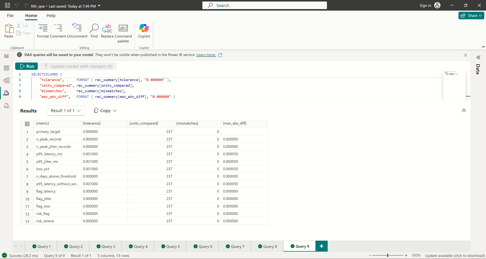

*Figure 15. 237 units compared, none present on one side only, none with a mismatch.*

```dax
// rec_summary with 6 decimals (the grid rounds to 2)
EVALUATE
SELECTCOLUMNS (
    rec_summary,
    "metric",         rec_summary[metric],
    "tolerance",      FORMAT ( rec_summary[tolerance], "0.000000" ),
    "units_compared", rec_summary[units_compared],
    "mismatches",     rec_summary[mismatches],
    "max_abs_diff",   FORMAT ( rec_summary[max_abs_diff], "0.000000" )
)
```


*Figure 16. 13 metrics x 237 units, 0 mismatches; largest difference 0.000050 in P95 latency, P95 jitter, loss and P95 without the worst day.*

| Metric group | Tolerance | Mismatches | Maximum absolute difference |
| :--- | :-: | :-: | :-: |
| `n_peak_records`, `n_peak_jitter_records`, `n_days_above_threshold` | exact | 0 | 0 |
| `flag_latency`, `flag_jitter`, `flag_loss`, `risk_flag`, `risk_severe` | exact | 0 | 0 |
| `primary_target` | exact | 0 | not applicable (text) |
| `p95_latency_ms`, `p95_jitter_ms`, `p95_latency_without_worst_day_ms` | 0.001 ms | 0 | 0.000050 |
| `loss_pct` | 0.001 pp | 0 | 0.000050 |

**Reading of the result.** The pipeline file stores four decimals and the audit computes without rounding, so a maximum difference of 0.000050 (half a unit of the fourth decimal) is the footprint of that rounding. It also shows that the comparison really ran: a maximum of exactly 0 in every numeric metric would have been suspicious. All differences are 20 times smaller than the tolerance. Null jitter coincides in the same 93 units, since `p95_jitter_ms` has 237 units compared and 0 mismatches.

### 10.5 Session 7B - Insufficient units

**Goal.** The 21 units below `N_MIN` are not in `unit_metrics`, so they are reconciled separately against `units_insufficient` (loaded in session 1 from `data/processed/units_insufficient_data.csv`). With 7A this covers the whole population: 237 + 21 = 258.

**Design.** Same pattern as `rec_units`: full outer join by `unit_id` (converted to `Int64` on the pipeline side, as in 10.3), presence flags and an exact comparison of the three columns the pipeline reports for these units: `primary_target`, `n_peak_records` and `n_peak_jitter_records`. No P95, loss or flags exist for them because they are not scored.

**`rec_insufficient`**
```m
// rec_insufficient: per-unit reconciliation of the units below N_MIN.
// Audit side: aud_unit_metrics with status "insufficient".
// Pipeline side: units_insufficient (data/processed/units_insufficient_data.csv).
// Same design as rec_units: full outer join by unit_id, presence flags, exact comparison per metric.
let
    Metrics = {"primary_target", "n_peak_records", "n_peak_jitter_records"},
    // buffered so the join does not enumerate the audit chain more than once
    AuditRows = Table.Buffer(Table.SelectRows(aud_unit_metrics, each [status] = "insufficient")),
    A = Table.RenameColumns(Table.SelectColumns(AuditRows, {"unit_id"} & Metrics),
            List.Transform({"unit_id"} & Metrics, each {_, "aud_" & _})),
    // unit_id must have the same type on both sides (text vs integer would match nothing)
    P0 = Table.TransformColumnTypes(Table.SelectColumns(units_insufficient, {"unit_id"} & Metrics), {{"unit_id", Int64.Type}}, "en-US"),
    P = Table.RenameColumns(P0, List.Transform({"unit_id"} & Metrics, each {_, "pip_" & _})),
    // full outer join: a unit present on one side only must show up
    Joined0 = Table.NestedJoin(A, {"aud_unit_id"}, P, {"pip_unit_id"}, "p", JoinKind.FullOuter),
    Joined = Table.ExpandTableColumn(Joined0, "p", List.Transform({"unit_id"} & Metrics, each "pip_" & _)),
    WithId = Table.AddColumn(Joined, "unit_id",
        each if [aud_unit_id] <> null then [aud_unit_id] else [pip_unit_id], Int64.Type),
    InAudit = Table.AddColumn(WithId, "in_audit", each [aud_unit_id] <> null, type logical),
    InPipeline = Table.AddColumn(InAudit, "in_pipeline", each [pip_unit_id] <> null, type logical),
    // all three metrics are exact (text or counts); null equals null only
    Ok = List.Accumulate(Metrics, InPipeline, (state, m) =>
        Table.AddColumn(state, "ok_" & m,
            each Record.Field(_, "aud_" & m) = Record.Field(_, "pip_" & m), type logical)),
    // metrics that do not match in each unit (0 = unit fully reconciled)
    Result = Table.AddColumn(Ok, "n_mismatch",
        each List.Count(List.Select(List.Transform(Metrics, (c) => Record.Field(_, "ok_" & c)), each _ = false)), Int64.Type)
in
    Result
```
`rec_insufficient` is loaded.

**Verification.**
```dax
// Reconciliation of insufficient units (blank shown as 0)
EVALUATE
ROW (
    "units",               COUNTROWS ( rec_insufficient ),
    "only_in_audit",       COALESCE ( CALCULATE ( COUNTROWS ( rec_insufficient ), rec_insufficient[in_pipeline] = FALSE () ), 0 ),
    "only_in_pipeline",    COALESCE ( CALCULATE ( COUNTROWS ( rec_insufficient ), rec_insufficient[in_audit] = FALSE () ), 0 ),
    "units_with_mismatch", COALESCE ( CALCULATE ( COUNTROWS ( rec_insufficient ), rec_insufficient[n_mismatch] > 0 ), 0 )
)
```

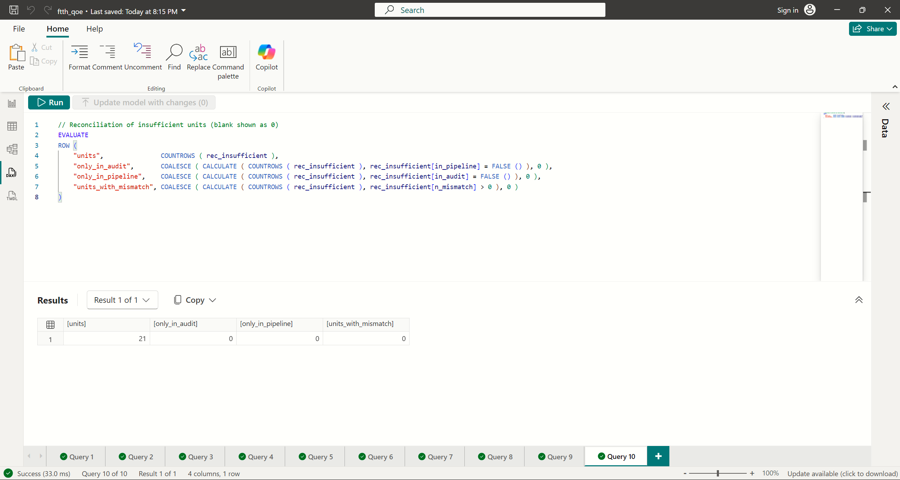

*Figure 17. 21 insufficient units compared, none present on one side only, none with a mismatch.*

**Result.** The 21 insufficient units match in primary server, peak latency records and peak jitter records. Together with 7A, every one of the 258 units is reconciled. The result and its limits are documented in `docs/reconciliation.md`.

## 11. Session 8 - Report pages and narrative (Visualize and analyze)

**Status:** pages 1-6 are built and verified against the pipeline output; a final review of the report and session 9 are pending.

**Goal.** Turn the verified model into a multi-page report in which each page answers one question and its title states the conclusion. The report only reads `unit_metrics`, `units_insufficient`, `variants_matrix`, `sensitivity_grid` and `data_quality_log`; the audit and reconciliation tables (`aud_*`, `rec_*`) are not used by any visual.

### 11.1 Design decisions

| Decision | Chosen | Rationale |
| :--- | :--- | :--- |
| Structure | One question per page, six pages plus a hidden `0 Model Check` page | Readability; each section can be reviewed and tested separately. |
| Page titles | Dynamic headline measure (a conclusion, not a label) | The reader gets the answer first. The sentence recomputes with the ISP slicer, so it never contradicts the numbers below it. |
| Theme | Custom theme file `powerbi/theme/ftth_qoe_theme.json` (View > Themes > Browse for themes) | One place for colours, fonts and card styling; reproducible from the repository. |
| Colour | Colour follows the entity: Cincinnati Bell blue, Frontier orange, Verizon green in every chart. Red `#D03B3B` is reserved for risk (at risk, severe, threshold lines). | Consistent reading across pages; status colour is never reused for an ISP. |
| Slicer | One ISP slicer, synced across pages (View > Sync slicers) | The reader filters once and every page stays coherent. |
| Comparison charts | Edit interactions set to *None* from the slicer | A chart that compares the three ISPs must keep showing all three when one is selected. |

The report page plan is:

| Page | Question it answers |
| :--- | :--- |
| 1 Overview | How many analyzed units are at risk, and where? |
| 2 Latency | Which units exceed the 20 ms P95 latency threshold, and by how much? |
| 3 At-risk units | Which units are at risk, and is the problem persistent or episodic (D-10)? |
| 4 Jitter and loss | What do jitter and loss add? How many units cannot be measured (D-07)? |
| 5 Sensitivity | How much does the result change with the choices that were not obvious (time zone, server, `N_MIN`)? |
| 6 Data quality and method | How were the 258 units filtered, and what are the limits? |

### 11.2 Theme and canvas

- **Theme file:** `powerbi/theme/ftth_qoe_theme.json`. Data colours `#2A78D6 #EB6834 #1BAF7A #EDA100 #E87BA4 #008300 #6250D6 #E34948`, page background `#F9F9F7`, visual background `#FCFCFB`, visual border `#E1E0D9` with radius 6, `good #0CA30C`, `neutral #FAB219`, `bad #D03B3B`. Callout text 28 pt Segoe UI Semibold; titles and headers 12 pt; labels 10 pt.
- **Canvas size:** every page must be **16:9, 1280 x 720**. New pages inherited a 1920 x 1080 canvas from the page they were created from, which compressed all visuals into the left two thirds of the page (**Format page > Canvas settings > Type: 16:9** corrects it). The size was fixed on every page.
- **Grid:** all positions are set numerically (Format visual > General > Properties > Size and Position), so pages line up. Margin 24 px, gap 16 px, content width 1232 px.

| Element | Horizontal | Vertical | Width | Height |
| :--- | :-: | :-: | :-: | :-: |
| Headline | 24 | 16 | 760 | 56 |
| ISP slicer | 800 | 16 | 456 | 56 |
| Content area | 24 | 88 | 1232 | 608 |

### 11.3 Page 1 - Overview

**Measure** (`_Measures`, display folder `4 Report`):

```dax
Headline Overview =
VAR _risk = [At Risk Units]
VAR _n = [Analyzed Units]
RETURN
    IF (
        _n = 0,
        "No analyzed units in the current selection",
        _risk & " of " & _n & " analyzed FTTH units (" & FORMAT ( [% At Risk], "0.0%" ) & ") "
            & IF ( _risk = 1, "is", "are" ) & " at risk"
    )
```

| Visual | Fields | Notes |
| :--- | :--- | :--- |
| Headline (card) | `Headline Overview` | Card background and border off; value 28 pt. |
| ISP slicer | `unit_metrics[isp]` | Horizontal button layout (Visual > Multi-button layout > Layout > Horizontal); button text size under Visual > Callout > Value (12 pt). |
| Four cards | `Population Units` ("Units in Scope"), `Analyzed Units`, `At Risk Units`, `Severe Units` | At Risk and Severe values in red `#D03B3B`. H 24 / 336 / 648 / 960, V 88, W 296, Height 96. |
| Clustered bar | Y-axis and Legend `isp`, X-axis `% At Risk`, tooltips `At Risk Units` and `Analyzed Units` | Title "% of analyzed units at risk, by ISP", data labels with one decimal, legend off. H 24, V 200, W 400, Height 496. Slicer interaction set to None. |
| Matrix | Rows: hierarchy `ISP -> State`; values `Analyzed Units`, `At Risk Units`, `% At Risk` | Sorted by `At Risk Units`, descending. H 440, V 200, W 816, Height 496. |

**Verification.** With no filter: headline "5 of 237 analyzed FTTH units (2.1%) are at risk", cards 258 / 237 / 5 / 1, matrix total 237 / 5 / 2.1 %. With Frontier selected: 62 / 61 / 1 / 0 and "1 of 61 ... (1.6%) is at risk", while the bar chart still shows the three ISPs. By ISP: Verizon 2 of 68 (2.9 %), Cincinnati Bell 2 of 108 (1.9 %), Frontier 1 of 61 (1.6 %).


*Figure 18. Page 1 (Overview) with no ISP selected.*

### 11.4 Page 2 - Latency

**Measure:**

```dax
Headline Latency =
VAR _n = [Analyzed Units]
VAR _f = [Latency Flags]
RETURN
    IF (
        _n = 0,
        "No analyzed units in the current selection",
        _f & " of " & _n & " analyzed units "
            & IF ( _f = 1, "exceeds", "exceed" ) & " 20 ms P95 latency"
    )
```

**Bins (group).** A histogram needs the P95 grouped into equal-width intervals. In the Data pane, right-click `unit_metrics[p95_latency_ms]` > **New group**, Group type **Bin**, Bin type **Size of bins**, size **2 ms**. The new field `p95_latency_ms (bins)` is a model column; it does not change `p95_latency_ms`. Each interval is closed on the left and open on the right ([22-24) contains 22.0 but not 24.0), and 20 ms is a bin edge, so no interval mixes units below and above the threshold.

| Visual | Fields | Notes |
| :--- | :--- | :--- |
| Stacked column chart | X-axis `p95_latency_ms (bins)` (continuous), Y-axis `Analyzed Units`, Legend `isp` | Title "P95 latency distribution of analyzed units vs the 20 ms threshold". Dashed red constant line at 20 on the X-axis (Analytics pane) with the label "Threshold 20 ms". H 24, V 88, W 816, Height 608. |
| Cards | `Analyzed Units`, `Latency Flags` | H 860, V 88 and V 200, W 396, Height 96. |
| Table | `unit_id`, `isp`, `state`, `p95_latency_ms` | Visual filter `flag_latency` = 1, sorted by P95 descending, P95 set to *Don't summarize*. Title "Units above the 20 ms threshold". H 860, V 312, W 396, Height 384. |

**Verification.** The headline reads "5 of 237 ..." and the table lists exactly the five units of the D-10 table in `docs/decisions.md` (4190285 Verizon MD 50.0; 24840041 Frontier CA 35.8; 25314177 Verizon NY 30.5; 24733221 Cincinnati Bell OH 24.0; 943226 Cincinnati Bell OH 23.1). The histogram's tail beyond 20 ms holds the same five units (the interval [22-24) holds two: 23.13 and 23.96 ms).

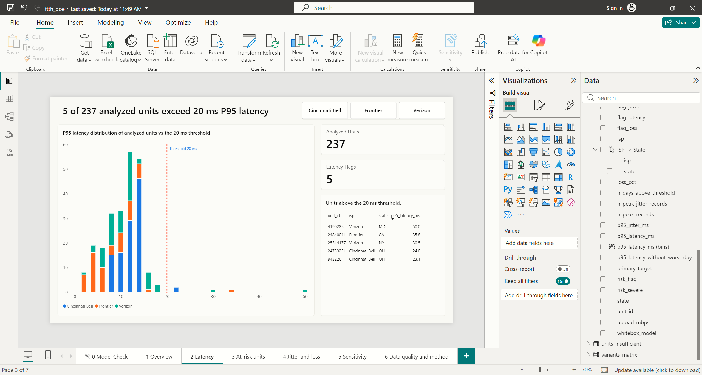

*Figure 19. Page 2 (Latency): five units above 20 ms; the rest of the distribution is concentrated between 10 and 14 ms.*

### 11.5 Page 3 - At-risk units

**Measures and column.** The persistent/episodic split of D-10 is descriptive only: it does not change `risk_flag` (see `docs/decisions.md`).

```dax
Persistent Flags =
COALESCE (
    CALCULATE ( [Latency Flags], unit_metrics[p95_latency_without_worst_day_ms] > 20 ),
    0
)

Episodic Flags =
COALESCE (
    CALCULATE ( [Latency Flags], unit_metrics[p95_latency_without_worst_day_ms] <= 20 ),
    0
)

Headline At Risk =
VAR _r = [At Risk Units]
RETURN
    IF (
        _r = 0,
        "No at-risk units in the current selection",
        _r & IF ( _r = 1, " unit is", " units are" ) & " at risk: "
            & [Persistent Flags] & " persistent, " & [Episodic Flags] & " episodic"
    )
```

Calculated column in `unit_metrics` (Table tools > New column), used as a label in the table:

```dax
Latency Pattern =
SWITCH (
    TRUE (),
    unit_metrics[flag_latency] <> 1, BLANK (),
    unit_metrics[p95_latency_without_worst_day_ms] > 20, "Persistent",
    "Episodic"
)
```

| Visual | Fields | Notes |
| :--- | :--- | :--- |
| Table | `unit_id`, `isp`, `state`, `p95_latency_ms`, `p95_latency_without_worst_day_ms`, `n_days_above_threshold`, `Latency Pattern` | Visual filter `risk_flag` = 1; sorted by P95 descending. H 24, V 88, W 816, Height 232. |
| Clustered bar | Y-axis `unit_id` (categorical), X-axis `p95_latency_ms` and `p95_latency_without_worst_day_ms` (Average) | Visual filter `risk_flag` = 1. Neutral greys `#52514E` and `#B9B7AE`, so the two series do not reuse ISP colours. Dashed red constant line at 20 ms. Legend on (two series). H 24, V 332, W 816, Height 364. |
| Cards | `Persistent Flags`, `Episodic Flags` | H 860, V 88 and V 200, W 396, Height 96. |
| Text box | Reading guide (definitions of persistent and episodic, D-10, unit 4190285) | H 860, V 312, W 396, Height 384; background `#FCFCFB`, border `#E1E0D9`. |

**Verification.** The headline reads "5 units are at risk: 4 persistent, 1 episodic", equal to the totals of Figure 13 (4 / 1). The P95 without the worst day of the five units (14.8, 35.6, 23.1, 22.7, 22.9 ms) and their days above the threshold (1, 16, 9, 7, 9) equal the D-10 table in `docs/decisions.md`. Only unit 4190285 falls below 20 ms when its worst day is removed.

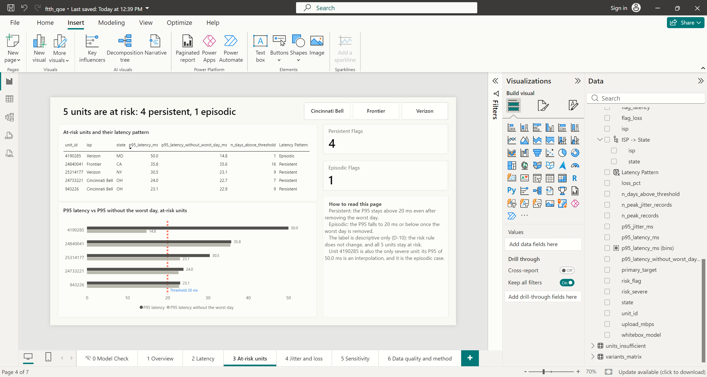

*Figure 20. Page 3 (At-risk units): 5 at risk, 4 persistent and 1 episodic.*

### 11.6 Page 4 - Jitter and loss

**Measures** (`_Measures`):

```dax
Headline Jitter =
VAR _j = [Jitter Flags]
VAR _n = [Analyzed Units]
RETURN
    IF (
        _n = 0,
        "No analyzed units in the current selection",
        IF (
            _j = 0,
            "No measurable unit exceeds 5 ms P95 jitter",
            _j & IF ( _j = 1, " unit exceeds", " units exceed" ) & " 5 ms P95 jitter"
        )
    )

% Null Jitter = DIVIDE ( [Units Null Jitter], [Analyzed Units] )
```

**Bins.** `p95_jitter_ms` is grouped in 0.5 ms intervals (New group > Bin). The observed range is 0.25 to 4.48 ms, so the histogram has nine readable intervals and the 5 ms threshold line falls just to the right of the last one. A histogram of `loss_pct` was tried and discarded: loss ranges from 0 to 1.66 % with a median of 0.007 %, so almost every unit falls in the first interval and the one unit above the threshold is invisible. The chart shows the ten highest values instead.

| Visual | Fields | Notes |
| :--- | :--- | :--- |
| Stacked column chart | X-axis `p95_jitter_ms (bins)`, Y-axis `Analyzed Units`, Legend `isp` | Visual filter `p95_jitter_ms` is not blank (excludes the 93 units without jitter). Constant line at 5 ms, dashed red, label "Threshold 5 ms". H 24, V 88, W 404, Height 400. |
| Clustered bar | Y-axis `unit_id` (categorical), X-axis `loss_pct` (Maximum), Legend `isp` | Visual filter Top N: 10 by `loss_pct`. Constant line at 1 %, label "Threshold 1 %". Data labels with 2 decimals. H 444, V 88, W 404, Height 400. |
| Cards | `Units Null Jitter`, `Jitter Flags`, `Loss Flags` | Titles "Units without measurable jitter", "Jitter flags", "Loss flags"; Loss Flags in red. H 860, V 88 / 200 / 312, W 396, Height 96. |
| Clustered bar | Y-axis and Legend `isp`, X-axis `% Null Jitter` | Slicer interaction set to None. H 24, V 504, W 824, Height 192. |
| Text box | Reading guide (D-07, highest jitter, loss outlier) | H 860, V 424, W 396, Height 272. |

**Verification.** Against `data/processed/ftth_qoe_unit_metrics.csv`: the histogram bars add up to the 144 units with measurable jitter (18, 46, 42, 7, 4, 19, 3, 3 and 2 per interval); the highest P95 jitter is 4.48 ms (unit 4190285) and the medians by ISP are 0.58 ms (Cincinnati Bell), 1.07 ms (Frontier) and 2.50 ms (Verizon); the 19 units between 2.5 and 3.0 ms are all Verizon. The highest loss is 1.66 % (unit 24840041, Frontier), then 0.83 % (unit 1002196, Verizon). Units without jitter: 69 of 108 for Cincinnati Bell (63.9 %), 7 of 61 for Frontier (11.5 %) and 17 of 68 for Verizon (25.0 %). The absence of jitter flags therefore applies to the 144 measurable units only, and it is a strong limitation for Cincinnati Bell.

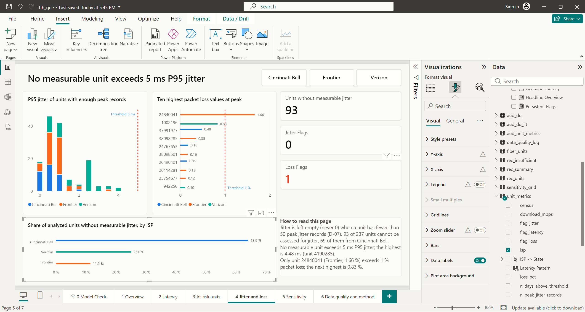

*Figure 21. Page 4 (Jitter and loss): no unit above 5 ms jitter, one unit above 1 % loss, and 93 units without measurable jitter.*

### 11.7 Page 5 - Sensitivity

The ISP slicer is not used on this page: `variants_matrix` and `sensitivity_grid` are disconnected scenario tables and no slicer filters them.

**Measure:**

```dax
Headline Sensitivity =
VAR _base = CALCULATE ( MAX ( variants_matrix[at_risk] ),
                variants_matrix[time_reading] = "local",
                variants_matrix[server_rule] = "primary_only" )
VAR _all = CALCULATE ( MAX ( variants_matrix[at_risk] ),
                variants_matrix[time_reading] = "local",
                variants_matrix[server_rule] = "all_servers" )
RETURN
    "Base case: " & _base & " units at risk; using all test servers raises it to " & _all
```

The columns of `sensitivity_grid` (`n_min`, `jitter_p95_ms`, `latency_p95_ms`, `loss_pct`) carry the Σ icon (default summarization). They are set to *Don't summarize* in Column tools so that slicers list their values instead of a range slider.

| Visual | Fields | Notes |
| :--- | :--- | :--- |
| Clustered bar | Y-axis `variants_matrix[time_reading]`, X-axis `at_risk` (Maximum), Legend `server_rule` | Greys `#52514E` (primary server, base) and `#B9B7AE` (all servers). H 24, V 88, W 520, Height 320. |
| Clustered column | X-axis `sensitivity_grid[n_min]` (categorical), Y-axis `at_risk` (Maximum) | Visual filters `latency_p95_ms` = 20, `jitter_p95_ms` = 5, `loss_pct` = 1. H 24, V 424, W 520, Height 272. |
| Two button slicers | `sensitivity_grid[n_min]`, `sensitivity_grid[jitter_p95_ms]` | Single select and Force selection On (Visual > Slicer settings > Selection); defaults 50 and 5 (the base case). Interaction with the `N_MIN` column chart set to None. H 560 and 916, V 88, W 340, Height 80. |
| Matrix | Rows `loss_pct`, Columns `latency_p95_ms`, Values `at_risk` (Maximum) | Totals off (a total of maxima is meaningless). Background gradient `#CDE2FB` to `#5598E7`. H 560, V 176, W 696, Height 332. |
| Text box | Reading guide | H 560, V 524, W 696, Height 172. |

**Why a single selection is required.** A matrix cell shows the maximum of `at_risk`. With one `N_MIN` and one jitter threshold selected, each cell holds exactly one grid row, so the maximum is the real value. Without a jitter selection the same cell showed 11 instead of 5, because it took the maximum over the three jitter thresholds.

**Verification.** `variants_matrix`: local/primary 5, local/all servers 21, UTC/primary 4, UTC/all servers 17. `N_MIN` 30 / 50 / 100: 7 / 5 / 1 (base thresholds). Matrix with `N_MIN` 50 and jitter 5:

| loss_pct \ latency (ms) | 20 | 30 | 50 |
| :--- | :-: | :-: | :-: |
| 0.05 | 22 | 20 | 19 |
| 0.10 | 14 | 12 | 11 |
| 0.50 | 6 | 4 | 3 |
| 1.00 | **5** | 3 | 2 |

The base-case cell (loss 1, latency 20) gives 5, equal to the base case. Across the whole grid the count ranges from 1 to 30.

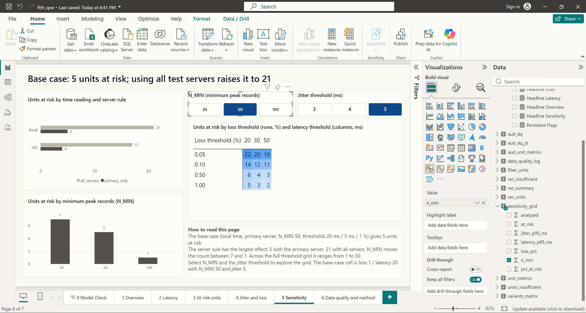

*Figure 22. Page 5 (Sensitivity): 5 at risk in the base case; 21 with all servers; 7 to 1 depending on `N_MIN`.*

### 11.8 Page 6 - Data quality and method

**Measure:**

```dax
Headline Method =
[Population Units] & " units in scope: " & [Analyzed Units] & " analyzed, " & [Insufficient Units] & " set aside"
```

| Visual | Fields | Notes |
| :--- | :--- | :--- |
| Stacked bar | Y-axis `isp`, X-axis `Analyzed Units` and `Insufficient Units` | Greys `#52514E` and `#B9B7AE`; slicer interaction None. H 24, V 88, W 520, Height 232. |
| Table | `data_quality_log[scope]`, `[rule]`, `[count]` | Visual filter excludes `scope` = `pipeline` (18 rows: cleaning counters of the latency and jitter files). H 24, V 336, W 520, Height 360. |
| Text box | How the result was built, and limits | H 560, V 88, W 696, Height 608. |

**Verification.** Headline "258 units in scope: 237 analyzed, 21 set aside". Analyzed / insufficient by ISP: Cincinnati Bell 108 / 12, Frontier 61 / 1, Verizon 68 / 8. The cleaning log matches `data/processed/data_quality_log.csv` (172,800 latency rows read, 9 exact duplicates removed, 172,791 rows after cleaning; 152,730 jitter rows read, 4 exact duplicates removed, 1 conflicting group dropped with 2 rows, 152,724 rows after cleaning).

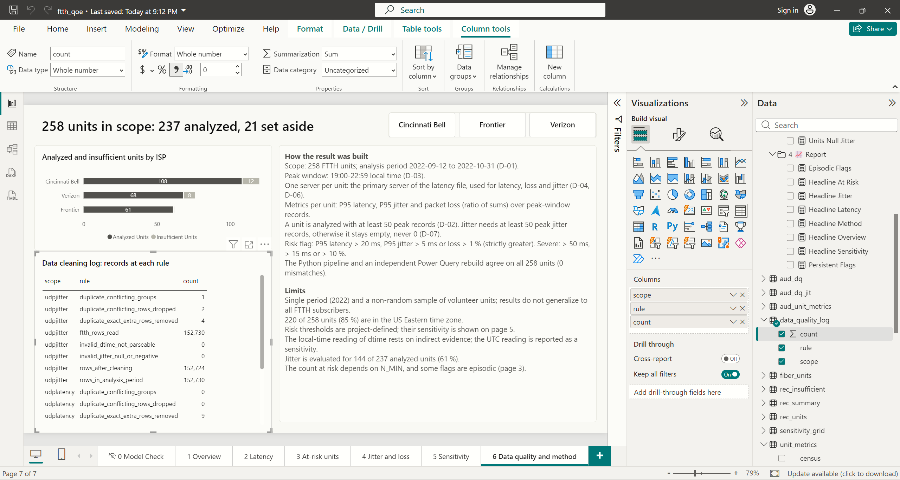

*Figure 23. Page 6 (Data quality and method).*

### 11.9 Report-building notes (Power BI Desktop 2.157.1354.0)

- The properties pane has **Size** (Height, Width) and **Position** (Horizontal, Vertical); there is no "X/Y" naming.
- The new ISP slicer is a button slicer. Orientation is under **Visual > Multi-button layout > Layout**; text size under **Visual > Callout > Value**.
- **Edit interactions** (Format tab) stays active until its button is pressed again; the filter and "none" icons on every visual show that the mode is still on.
- Pasting a slicer onto another page offers **Sync visuals**; *Sync* keeps the ISP selection across pages. Check View > Sync slicers for the pages where it is shown.
- The text box's **+ Value** button opens a dynamic-value dialog (Copilot); plain text is typed in the body of the box. Red spelling underlines come from the Windows proofing setting, not from Power BI; they do not appear in the published report.
- A numeric field with the Σ icon, dropped on an empty canvas, becomes a card, and dropped in a slicer it becomes a range slider. Set *Don't summarize* in Column tools for columns that are used as categories or slicer values. Value wells of charts cannot use *Don't summarize*; with one row per unit, *Maximum* returns the unit's own value.
- Slicer options (Single select, Force selection) are under **Visual > Slicer settings > Selection** and exist only after the visual is a slicer.
- Subtotals of a matrix that shows a maximum (for example `at_risk` per grid cell) are maxima, not sums: switch them off.
- Keep headlines under about 50 characters at 28 pt in a 760 px card; longer text is cut with an ellipsis.
- Screenshots: use **Win+Shift+S**. Alt+PrtScn activates the KeyTips and they appear in the image.

## 12. Modelling notes

- **Flat by design.** `unit_metrics` is the single fact table (237 analyzed units). ISP, state and Whitebox model are text columns in the same table.
- **Population denominator.** The 258-unit population is computed with a measure (analyzed + `units_insufficient`), not through a relationship.
- **Scenario tables are disconnected.** `variants_matrix` and `sensitivity_grid` hold pre-computed scenario results and are not filtered by slicers.
- **Null jitter (D-07).** 93 analyzed units have no jitter result. Aggregations ignore blanks; they are never replaced with 0.
- **Slicer limitation.** `units_insufficient` is reached only through `TREATAS` on `isp` and `state`. A slicer on any other `unit_metrics` column (Whitebox model, census, speed tiers) filters analyzed units but not insufficient ones, so `Insufficient Units` and `Population Units` ignore it. Population by ISP and state is exact; other cuts need a dimension table.
- **Trade-off.** A star schema would enable cross-filtering and reuse; out of scope here.

## 13. Roadmap

| Session | Content | PL-300 domain |
| :-: | :--- | :--- |
| 3 | Base DAX measures (analyzed, insufficient, at risk, % at risk) - **done** | Model the data |
| 4A | Audit phase 1a: latency cleaning, row counts - **done** | Prepare the data |
| 4B | Audit phase 1b: peak window, primary server, P95 latency, loss, flags - **done** | Prepare the data |
| 5 | Audit phase 2: jitter cleaning (5A), P95 jitter with minimum 50 records (5B) - **done** | Prepare the data |
| 6 | Audit phase 3: `risk_flag`, `risk_severe` and D-10 columns - **done** | Prepare the data |
| 7A | Per-`Unit ID` reconciliation of the 237 analyzed units - **done** | Analyze the data |
| 7B | Reconciliation of the 21 insufficient units; result in `docs/reconciliation.md` - **done** | Analyze the data |
| 8 | Report pages and narrative: pages 1-6 **done**; final review pending | Visualize and analyze |
| 9 | Performance, documentation, publishing | Manage and secure |